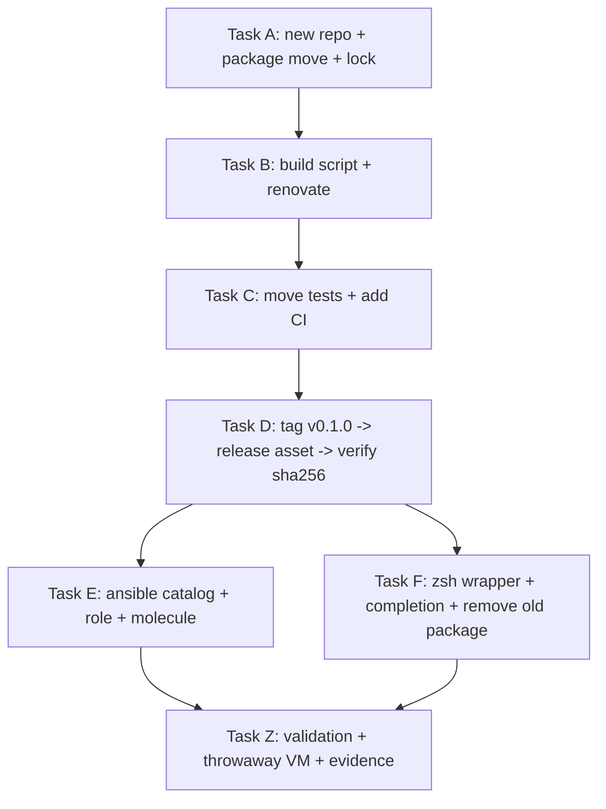

# extract packaging Implementation Plan

> **Required sub-skills:** subagent-driven-development, plan-execution

**Goal:** Ship `extract` as a byte-reproducible single-file zipapp published as a GitLab release, installed on hosts by the Ansible `release_artifact` role, with the zsh wrapper delegating to the installed binary.

**Architecture:** Split the Python package into a new repo `cupric/extract` that vendors its full pure-Python closure (`typer` + `rich` + transitive, `libarchive-c`) into a `.pyz`, built from a lockfile compiled for the Python 3.10 floor. `cupric/ansible` pins the artifact in `release_artifacts.yml` and installs it through `roles/release_artifact` behind a Python ≥ 3.10 preflight, adding the native tool chain to `zsh_packages`. `cupric/zsh` keeps only the shell wrapper, completion, and wrapper tests; the package, its shim, and its tests move out.

**Tech Stack:** Python 3.10+, typer, libarchive-c, `uv pip compile`, `python -m zipapp`, GitLab CI + generic package registry + release asset links, Ansible, pytest, molecule.

**Spec:** `docs/specs/2026-11-04-extract-packaging.md` (Draft, 3 review rounds, 0 Critical). This plan implements its `## Wiring Checklist` 1:1 and adds Task D (publish gate) and Task Z (validation incl. a throwaway VM).

---

## Scope Check

One subsystem: packaging and delivery of the `extract` tool. The three repos are not independent subsystems — each link in the chain (build → publish → pin → install → wrap) is useless without its neighbours, so this stays a **single plan**. It is deliberately a single file rather than a `docs/plans/<slug>/` directory: the handover and this repo's document conventions name `docs/plans/YYYY-MM-DD-extract-packaging.plan.md`, and `plan_status` tracks one file per plan. The tasks are still decomposed by repo so they can be dispatched to subagents with disjoint write scopes (see the Dependency Graph and each task's `Files:` list).

## Repositories and Workspaces

| Repo | Working copy | Branch | Protected? |
|------|--------------|--------|-----------|
| `cupric/extract` (new) | `/home/cupric/dev/extract` | `main` | No (new project) |
| `cupric/ansible` | `/home/cupric/dev/ansible/.worktrees/extract-packaging` | `feature/extract-packaging` | `develop` is protected |
| `cupric/zsh` | `/home/cupric/dev/zsh/.worktrees/extract-packaging` | `feature/extract-packaging` | `master` is protected |

## File Structure (Responsibility Map)

New repo `cupric/extract`:

| Path | Responsibility |
|------|----------------|
| `extract/__init__.py` | `__version__` — build-side source of truth |
| `extract/cli.py` | typer CLI surface (moved unchanged) |
| `extract/{engine,handlers,orchestration,discovery,passwords}.py` | extraction behaviour (moved unchanged) |
| `extract/logutil.py` | stderr output discipline; optional `standard_logging` |
| `extract/__main__.py` | zipapp entry point |
| `bin/extract.py` | dev shim (checkout-only) |
| `requirements.in` / `requirements.txt` | direct deps / compiled py3.10 lock (artifact input) |
| `requirements-dev.txt` | dev extras (`-r requirements.txt` + pytest) |
| `scripts/build-zipapp.sh` | reproducible `.pyz` build: stage → mtime normalise → zipapp → closure assert → sha256 |
| `.gitlab-ci.yml` | test gate + tag-triggered build/upload/release |
| `renovate.json` | dependency automation for the lock |
| `tests/` | 183 package tests + fixtures (moved) |

`cupric/ansible`:

| Path | Responsibility |
|------|----------------|
| `inventory/group_vars/all/release_artifacts.yml` | pin (`version`, `asset`, `sha256`) — deploy-side source of truth |
| `docs/reference/release-artifacts.md` | catalog row (CI-enforced docs↔catalog sync) |
| `roles/zsh/vars/main.yml` | native runtime (`libarchive`) + fallback tool chain per distro |
| `roles/zsh/tasks/main.yml` | best-effort `unrar`; Python-floor preflight → `release_artifact` → warning |
| `roles/zsh/molecule/default/verify.yml` | floor-conditional install/absence assertions |

`cupric/zsh`:

| Path | Responsibility |
|------|----------------|
| `custom/extract.zsh` | flag-pattern wrapper; delegates to `command extract` (or the `ZBIN` test seam) |
| `completion/_extract` | `#compdef extract` completion |
| `tests/test_wrapper.py` | 13 moved + 2 new wrapper tests |
| `zshrc` | loads the wrapper after sheldon; stale comments updated |
| `.gitignore` | adds `.pytest_cache/` |

Removed from `cupric/zsh`: `libraries/python/extract/`, `bin/extract.py`, the package tests, `tests/fixtures/`, `tests/conftest.py`.

The new `cupric/extract` repo has no history, no protection, and no other consumers, so it is built directly on `main`. The worktree rule in `zsh/AGENTS.md` and `ansible/AGENTS.md` applies to the two existing repos. The **zsh worktree is needed before Task C** (the wrapper test moves there) and the **ansible worktree before Task E**.

## Workspace Preparation (before Task A)

Create both worktrees now, so every later task has a valid target. Follow `using-git-worktrees` if the worktrees already exist.

```bash
# zsh: the spec + handover commit is local-only right now; push it so the
# worktree base and the future MR base agree.
cd /home/cupric/dev/zsh
git push origin master
git worktree add -b feature/extract-packaging .worktrees/extract-packaging origin/master
# plan-execution commits the plan inside the worktree; the plan file is untracked here.
cp docs/plans/2026-11-04-extract-packaging.plan.md .worktrees/extract-packaging/docs/plans/

# ansible: branch off develop, then bootstrap the devcontainer + keys
cd /home/cupric/dev/ansible
git fetch origin
git worktree add -b feature/extract-packaging .worktrees/extract-packaging origin/develop
cd .worktrees/extract-packaging
just setup          # devcontainer up + sync-keys + install-hooks
```

Verify:

```bash
git -C /home/cupric/dev/zsh/.worktrees/extract-packaging status --short --branch
git -C /home/cupric/dev/ansible/.worktrees/extract-packaging status --short --branch
ls /home/cupric/dev/ansible/.worktrees/extract-packaging/keys/libvirt_vm_testing_ed25519
```

Expected: both branches are `feature/extract-packaging` and the libvirt test key exists in the ansible worktree (molecule's `sync-keys` copies it from the primary checkout). Confirm the container mount path, which Task Z hard-codes:

```bash
devcontainer exec --workspace-folder /home/cupric/dev/ansible/.worktrees/extract-packaging -- pwd
```

Expected: `/workspaces/extract-packaging`. If it differs, replace that path in Task Z Step 5's `libvirt_vm_testing_inventory_ssh_key`.

If the `git push origin master` is rejected (protected branch), branch from the local `master` instead (`git worktree add -b feature/extract-packaging .worktrees/extract-packaging master`); the spec commit then rides along in the MR, which is harmless.

## Dependency Graph



Serial constraints (do not reorder):

- Task D needs the built artifact from Task B and the merged test suite from Task C (the tag must point at a commit whose CI test job is green).
- Task E needs `EXTRACT_SHA256` captured in Task D (the catalog pin).
- Task F needs the installed binary semantics from Task E only for the VM check; the code change itself is independent, but its push must precede Task Z's VM wrapper check (the VM fetches the wrapper from the branch over HTTPS).
- Task Z's VM check needs both the release (Task D) and the ansible role changes (Task E).

## Task Summary

| Task | Description | Status |
|------|-------------|--------|
| A | Create `cupric/extract`, move the package, make `standard_logging` optional, add entry point/shim/locks (spec steps 1–7) | done |
| B | Reproducible zipapp build script + Renovate (spec steps 8, 10) | done |
| C | Move the 183 package tests, split out the 13 wrapper tests, add CI (spec steps 9, 11–12) | done |
| D | Publish `v0.1.0`, verify the anonymous download URL and pin the sha256 | done |
| E | Ansible catalog/docs/native packages/role wiring/molecule verify (spec steps 13–17) | done |
| F | zsh wrapper delegation, completion, remove old package (spec steps 18–20) | done |
| Z | Full validation incl. throwaway libvirt VM install + evidence files | done |

## Verified Facts (re-check only if the world changed)

Re-verified on `roci` on 2026-11-04 while writing this plan:

1. **`uv pip compile --python-version 3.10 requirements.in` resolves 8 distributions, not 9.** `typer==0.27.3` vendors `typer/_click` and no longer requires the `click` distribution:

   ```text
   annotated-doc==0.0.5
   libarchive-c==5.3
   markdown-it-py==4.2.0
   mdurl==0.1.2
   pygments==2.21.0
   rich==15.0.0
   shellingham==1.5.4
   typer==0.27.3
   ```

   The spec's "9 distributions incl. `click==8.5.0`" is stale. Do **not** add `click` to `requirements.in`; it is not imported by the bundle.
2. **The spec's build recipe works as written.** A prototype build produced a 1,768,009-byte `.pyz`; two consecutive rebuilds produced the same sha256 (`touch -h -d '2000-01-01'` is what makes that true).
3. **The exit matrix is exactly** `--help` → 0, no args → 2, `-p x -P f` → 2, `-p ''` → 2, missing path → 1, once `logutil` tolerates a missing `standard_logging`. Before that change every invocation exits 1 with `ModuleNotFoundError: No module named 'standard_logging'`.
4. **`libarchive` is imported lazily** (`handlers.py` imports it inside `available()`/`extract()`), so `extract --help` succeeds on a host without `libarchive.so`; real extraction needs the system library.
5. **Anonymous download from the generic package registry works** on this GitLab for public projects (`GET .../projects/76/packages/generic/rust-tools/v0.4.0/sheldon-...` → 200 with no token). No deploy token is needed for `cupric/extract` while it stays public.
6. **Instance runner `gitlab-runner` (id 2) is online and shared**, so a new project inherits CI.
7. **Package names were checked inside the molecule images** (`test-debian13`, `test-alma9`, `test-fedora40`, `test-archlinux`): every name used in Task E exists. On Alma 9 and Fedora 40, `rpm`/`zstd`/`bzip2`/`xz` are already installed in the base image (`dnf list --available` reports them missing only because they are installed).
8. **`ci/check_release_artifacts.py` requires** any entry with `checksum_source: captured_at_bump` to be listed in `release_artifacts_checksum_pending`; the sha256 is still verified by the role when present.
9. **Host prerequisites for Task Z:** `virsh`/`virt-install` present, `sudo` passwordless, `keys/libvirt_vm_testing_ed25519` present, `inventory/test_vms.ini` is **tracked** and must be restored after the VM run.
10. **Baseline suite:** `python3 -m pytest tests -q` in `/home/cupric/dev/zsh` → `196 passed, 1 skipped, 1 xfailed, 7 xpassed`. Split: 183 + 13.

## Gotchas (read before starting)

- **Profile.** Execution needs `write`, `agent`, or `agent-minimal`. Plan-mode sub-agents cannot write.
- **Python floor is 3.10 and Alma 9 ships 3.9.** The role must *skip with a warning*, never fail. `extract/cli.py` uses PEP 604 annotations.
- **Do not port the CLI to argparse.** `extract/cli.py` is unchanged; only `logutil.py`, `__main__.py`, and the dev shim change.
- **`pip install --no-deps --target` + a compiled lock** is what makes the bundle complete. `--no-deps` omits nothing audibly, hence the `markdown_it/__init__.py` assert.
- **Compile the lock for the floor** (`--python-version 3.10`), never the build interpreter.
- **Normalise mtimes before `zipapp`** — otherwise the pinned sha256 changes on every rebuild and pipeline retries fail.
- **libvirt VM creation is unavailable on `roci`.** The running kernel (`7.2.11-arch1-1`) has no matching module tree (`/lib/modules` holds `6.18.60-1-lts` and `7.2.14-arch1-1`), so `tun` cannot be loaded and `virt-install` fails with `Unable to open /dev/net/tun`. Until the host reboots into an installed kernel, use the Proxmox ephemeral VM instead (Task Z Step 5 note).
- **Ansible VM role runs need `zsh_target_user` passed explicitly.** `playbooks/zsh.yml` renders it in a pre-task name before the role defaults it; a bare run fails with `'zsh_target_user' is undefined`.
- **Byte-reproducibility holds per environment, not across them.** `python3 -m zipapp` writes members in filesystem readdir order, so the same commit built on the host and in the CI container yields different digests (verified for v0.1.0: local `1b54edf3…`/`d66a3a43…`, CI `dcb5d6ce…`; bundle contents are identical entry-for-entry). The catalog pins the **CI** artifact because that is what the release URL serves. Do not use "rebuild locally and compare" as a verification step. A sorted-entry zip writer is the follow-up fix if cross-machine reproducibility is ever required.
- **Debian `unrar-free` is not the `unrar` binary** the handler probes. `unrar` stays best-effort (`failed_when: false`); unencrypted RAR still works via libarchive.
- **Ansible execution context.** The libvirt VM creation runs on the **host** (it drives `libvirtd`/QEMU; the devcontainer mounts neither). Role runs run **inside the devcontainer** per `ansible/AGENTS.md`. Both are spelled out in Task Z. Task Z is the long pole: a full `playbooks/zsh.yml` run on a fresh VM (Go, Rust, carapace, fzf, extract) takes 15–25 minutes. Give it a 30-minute ceiling, re-run after a failure instead of rebuilding the VM (the role is idempotent), and never run molecule concurrently — they share the Docker daemon and compete for CPU.
- **The release-download URL is the only unverified link in the chain.** The generic package registry is proven anonymously readable on this instance, but `/-/releases/<tag>/downloads/<name>` cannot be exercised until `cupric/extract` exists. Task D Step 3 is the gate; if it 404s, Task D Step 3 has the manual asset-link and generic-registry fallbacks.
- **`release_artifacts_checksum_pending` is a permanent-by-design listing here, not "no checksum".** `checksum_source: captured_at_bump` forces it (lint rule 1), while the role still verifies the pinned sha256. Do not "fix" the warning by switching to `upstream_checksums` (there is no upstream ledger) or by pinning without a checksum.
- **Merge ordering matters for users.** Task F deletes `bin/extract.py` from `cupric/zsh`; any host that has not yet run the ansible role loses the tool until it does. Land/roll out the ansible MR (`cupric/ansible` → `develop` → `master`) before or together with the zsh MR. The wrapper degrades with an actionable message (`extract: the extract tool is not installed (run the ansible zsh role)`), never a silent failure.
- **Host paths do not exist inside the devcontainer.** The worktree is mounted at `/workspaces/<worktree-name>` (e.g. `/workspaces/extract-packaging`), so any inventory generated on the host with an absolute host path for the SSH key will fail from the container. Task Z handles this with `-e libvirt_vm_testing_inventory_ssh_key=/workspaces/extract-packaging/keys/libvirt_vm_testing_ed25519`; the alternative is `ssh-add keys/libvirt_vm_testing_ed25519` on the host before `devcontainer up` (the agent socket is mounted into the container).
- **One molecule run at a time** across all worktrees (shared Docker daemon).
- **New projects on this instance may have CI disabled.** `cupric/extract` was created with `builds_access_level: disabled`, so the first push produced no pipeline and `pipelines` API calls returned 403. Fix once with `glab api --method PUT projects/<id> -f builds_access_level=enabled`; record the change, since the plan otherwise assumes new projects inherit CI.
- **Never commit `inventory/test_vms.ini`** — the libvirt playbook rewrites it; restore it after Task Z.
- **`release_artifact` keys on `version+arch`.** A `requirements.txt` bump alone rebuilds at the same version and hosts report "already installed". A bump must bump `__version__`, tag, and re-capture the sha256.

---

### Task A: Create `cupric/extract` and move the package

**Files:**
- Create: `/home/cupric/dev/extract/.gitignore`
- Create: `/home/cupric/dev/extract/README.md`
- Create: `/home/cupric/dev/extract/LICENSE.md`
- Create: `/home/cupric/dev/extract/extract/` (7 modules moved from `zsh/libraries/python/extract/`)
- Create: `/home/cupric/dev/extract/extract/__main__.py`
- Create: `/home/cupric/dev/extract/bin/extract.py`
- Create: `/home/cupric/dev/extract/requirements.in`
- Create: `/home/cupric/dev/extract/requirements.txt`
- Create: `/home/cupric/dev/extract/requirements-dev.txt`
- Modify: `/home/cupric/dev/extract/extract/logutil.py`

- [x] **Step 1: Create the GitLab project and clone it**

Project creation and the local checkout are separate, explicit operations (do not rely on `glab repo create`'s clone heuristic):

```bash
glab api --method POST projects \
  -f name=extract -f path=extract -f visibility=public \
  -f description="Password and recursive archive extraction (single-file zipapp)"

mkdir -p /home/cupric/dev/extract
cd /home/cupric/dev/extract
git init -b main
git remote add origin git@gitlabssh.timepiggy.com:cupric/extract.git
git remote -v
```

Expected: the API call returns a project JSON body with `"path_with_namespace":"cupric/extract"`, and `git remote -v` shows the `gitlabssh.timepiggy.com:cupric/extract.git` remote (matching the form used by `cupric/zsh`). If the project already exists, skip the `glab api` call and go straight to `git init` + `git remote add`.

- [x] **Step 2.1: Add `.gitignore`**

Create `.gitignore`:

```text
__pycache__/
*.py[cod]
.pytest_cache/
.venv/
dist/
```

- [x] **Step 2.2: Copy the license**

Create `LICENSE.md` with the same MIT license text as `/home/cupric/dev/zsh/LICENSE.md` (copy the file, do not retype it):

```bash
cp /home/cupric/dev/zsh/LICENSE.md /home/cupric/dev/extract/LICENSE.md
```

- [x] **Step 2.3: Write `README.md`**

Create `README.md`:

```markdown
# extract

Password and recursive archive extraction.

`extract` is a Python CLI (typer) shipped as a **single-file, byte-reproducible
zipapp**. It vendors its pure-Python dependencies; the host only needs
`libarchive.so` and the external tool chain (`7z`, `unzip`, `tar`, `cpio`, …).

## Requirements

- Python **3.10 or newer** (the vendored `typer`/`rich` floor)
- System `libarchive.so` ≥ 3.2 (Debian `libarchive13`, Arch/Fedora `libarchive`)
- `7z`, `unzip`, `tar`, `cpio`, `cabextract`, `lzip`, `ncompress`, `lz4`, `zstd`, … for the fallback chain

Ansible installs both the artifact and the tool chain — see `cupric/ansible`,
`roles/zsh`.

## Usage

```bash
extract archive.zip
extract -p 'secret' encrypted.zip
extract -P passwords.txt -r archive.7z
extract -R ~/Downloads            # every archive below a directory
```

Status output goes to stderr; passwords are never logged.

## Development

```bash
python3 -m pip install -r requirements-dev.txt
python3 bin/extract.py --help
python3 -m pytest tests/ -q
```

## Building the artifact

```bash
./scripts/build-zipapp.sh 0.1.0
sha256sum dist/extract-0.1.0.pyz
```

The build is reproducible: rebuilding the same commit produces the same
sha256. Bumping `requirements.txt` alone is not a release — bump
`extract/__init__.py:__version__`, tag `v<version>`, and re-capture the
sha256 for the Ansible catalog.

## Release

CI builds and publishes `extract-<version>.pyz` on every `v*` tag: it uploads
the file to the generic package registry and links it into the GitLab release
as `/-/releases/v<version>/downloads/extract-<version>.pyz`.
```

- [x] **Step 3: Move the package modules**

```bash
mkdir -p /home/cupric/dev/extract/extract
cp /home/cupric/dev/zsh/libraries/python/extract/*.py /home/cupric/dev/extract/extract/
rm -rf /home/cupric/dev/extract/extract/__pycache__
cd /home/cupric/dev/extract
python3 -c 'import extract; print(extract.__version__)'
```

Expected: `0.1.0`. The eight moved files are `__init__.py`, `cli.py`, `discovery.py`, `engine.py`, `handlers.py`, `logutil.py`, `orchestration.py`, `passwords.py`.

- [x] **Step 4: Write the optional-standards `logutil.py`**

Overwrite `extract/logutil.py`:

```python
"""Output discipline (spec §5): all of extract's status goes to stderr.

Uses standard_logging when importable; otherwise a simplified stderr logger.
"""

import sys

try:
    from standard_logging import log as _log  # type: ignore[import-not-found]
except ImportError:  # standards library not installed — simplified fallback
    def _log(level: str, *messages: str) -> None:
        sys.stderr.write(f"[{level}] {' '.join(str(m) for m in messages)}\n")


def log(level: str, *messages: str) -> None:
    """Log via standard_logging when present, forcing every level to stderr."""
    real_stdout = sys.stdout
    sys.stdout = sys.stderr
    try:
        _log(level, *messages)
    finally:
        sys.stdout = real_stdout


def redact(text: str, candidates: list[str]) -> str:
    """Mask every candidate in `text` (spec §8.3 — never log passwords)."""
    for candidate in candidates:
        if candidate:
            text = text.replace(candidate, "***")
    return text
```

- [x] **Step 5: Write the zipapp entry point**

Create `extract/__main__.py`:

```python
from extract.cli import app

app()
```

No `sys.exit` wrapper: typer/click raise `SystemExit` with the correct code.

- [x] **Step 6: Write the dev shim**

Create `bin/extract.py`:

```python
#!/usr/bin/env python3
"""dev shim — run the extract package from the checkout."""

import sys
from pathlib import Path

sys.path.insert(0, str(Path(__file__).resolve().parent.parent))
from extract.cli import app  # noqa: E402

if __name__ == "__main__":
    app()
```

```bash
chmod +x /home/cupric/dev/extract/bin/extract.py
```

- [x] **Step 7: Write `requirements.in`**

```text
# requires Python >= 3.10 (typer/click floor)
typer>=0.12
libarchive-c>=3
```

- [x] **Step 8: Compile and commit the lock**

```bash
cd /home/cupric/dev/extract
uv pip compile --python-version 3.10 requirements.in -o requirements.txt
cat requirements.txt
```

Expected: 8 pinned distributions (annotated-doc, libarchive-c, markdown-it-py, mdurl, pygments, rich, shellingham, typer) plus their `# via` comments. Do **not** edit the pins by hand and do **not** compile with the local interpreter's version.

- [x] **Step 9: Write `requirements-dev.txt`**

```text
-r requirements.txt
pytest==9.2.0
```

`-r requirements.txt` is required: the tests import `extract` (which imports `typer` at module scope) and run `bin/extract.py` as a subprocess, so a dev environment with only `pytest` fails with `ModuleNotFoundError: No module named 'typer'`. Dev-only pins stay here; the artifact never installs them.

- [x] **Step 10: Verify CLI parity through the shim**

```bash
cd /home/cupric/dev/extract
python3 bin/extract.py --help >/dev/null; echo "help=$?"
python3 bin/extract.py >/dev/null 2>&1; echo "noargs=$?"
python3 bin/extract.py -p x -P f whatever.zip >/dev/null 2>&1; echo "conflict=$?"
python3 bin/extract.py -p '' whatever.zip >/dev/null 2>&1; echo "empty=$?"
python3 bin/extract.py does-not-exist.zip >/dev/null 2>&1; echo "missing=$?"
```

Expected: `help=0`, `noargs=2`, `conflict=2`, `empty=2`, `missing=1`.

- [x] **Step 11: Functional smoke through the shim**

```bash
cd "$(mktemp -d)"
cp /home/cupric/dev/zsh/tests/fixtures/archives/plain/plain.tar.gz .
python3 /home/cupric/dev/extract/bin/extract.py plain.tar.gz
test -f plain/a.txt && echo SHIM_OK
```

Expected: `[success] plain.tar.gz -> plain` on stderr and `SHIM_OK`.

- [x] **Step 12: Commit and push**

```bash
cd /home/cupric/dev/extract
git add -A
git commit -m "feat: import extract package with zipapp packaging scaffolding"
git push -u origin main
```

Expected: push succeeds; `git status` is clean. There is no pipeline yet — the repo has no `.gitlab-ci.yml`; CI is added in Task C Step 8 once the test suite exists.

---

### Task B: Reproducible artifact build and Renovate

**Files:**
- Create: `/home/cupric/dev/extract/scripts/build-zipapp.sh`
- Create: `/home/cupric/dev/extract/renovate.json`

- [x] **Step 1: Write the build script**

Create `scripts/build-zipapp.sh`:

```bash
#!/usr/bin/env bash
set -euo pipefail

# Deterministic zip headers: zipfile stores localtime, so pin TZ.
export TZ=UTC

VERSION="${1:?usage: build-zipapp.sh <version>}"
REPO_ROOT="$(cd "$(dirname "${BASH_SOURCE[0]}")/.." && pwd)"
STAGE="$(mktemp -d)"
trap 'rm -rf "$STAGE"' EXIT

python3 -m pip install --quiet --disable-pip-version-check --no-deps \
  --target "$STAGE" -r "$REPO_ROOT/requirements.txt"

mkdir -p "$STAGE/extract"
cp -r "$REPO_ROOT/extract/." "$STAGE/extract/"
find "$STAGE" \( -name '__pycache__' -o -name '*.pyc' -o -name '*.dist-info' \) -prune -exec rm -rf {} +
rm -rf "${STAGE:?}/bin"

cp "$REPO_ROOT/extract/__main__.py" "$STAGE/__main__.py"

# Deterministic archive: normalise mtimes BEFORE zipping. Use a date >= 1980
# (zipfile rejects pre-1980 timestamps); @0 would raise under `set -e`.
find "$STAGE" -exec touch -h -d '2000-01-01T00:00:00Z' {} +

mkdir -p "$REPO_ROOT/dist"
python3 -m zipapp "$STAGE" -c \
  -o "$REPO_ROOT/dist/extract-${VERSION}.pyz" \
  -p "/usr/bin/env python3"

# Guard against a silently incomplete bundle (--no-deps omits nothing audibly).
# grep -c consumes the whole listing (grep -q would SIGPIPE unzip under pipefail).
unzip -l "$REPO_ROOT/dist/extract-${VERSION}.pyz" | grep -c 'markdown_it/__init__.py' >/dev/null \
  || { echo "ERROR: dependency closure incomplete" >&2; exit 1; }

chmod 0755 "$REPO_ROOT/dist/extract-${VERSION}.pyz"
sha256sum "$REPO_ROOT/dist/extract-${VERSION}.pyz" | awk '{print $1}'
```

```bash
chmod +x /home/cupric/dev/extract/scripts/build-zipapp.sh
shellcheck /home/cupric/dev/extract/scripts/build-zipapp.sh
```

Expected: shellcheck exits 0.

- [x] **Step 2: Build and record the digest**

```bash
cd /home/cupric/dev/extract
./scripts/build-zipapp.sh 0.1.0 | tee /tmp/extract-sha.txt
ls -l dist/extract-0.1.0.pyz
```

Expected: one sha256 line (64 hex chars). Size ≈ 1.8 MB. **Record this digest** — Task D compares it with the CI build and Task E pins it.

- [x] **Step 3: Prove the build is reproducible**

```bash
cd /home/cupric/dev/extract
sha1=$(sha256sum dist/extract-0.1.0.pyz | awk '{print $1}')
./scripts/build-zipapp.sh 0.1.0 >/dev/null
sha2=$(sha256sum dist/extract-0.1.0.pyz | awk '{print $1}')
echo "$sha1"; echo "$sha2"; test "$sha1" = "$sha2" && echo REPRODUCIBLE
```

Expected: both lines identical and `REPRODUCIBLE`. Also verify the timezone pin (zip headers store localtime):

```bash
TZ=America/New_York ./scripts/build-zipapp.sh 0.1.0
TZ=Asia/Tokyo ./scripts/build-zipapp.sh 0.1.0
```

Expected: both print the same digest as the default-environment build. Without the script's `export TZ=UTC`, the digest changes with the caller's timezone and the CI/local digests diverge.

- [x] **Step 4: Assert the hermetic exit matrix**

```bash
cd /home/cupric/dev/extract
python3 -S -E dist/extract-0.1.0.pyz --help >/dev/null;           echo "help=$?"
python3 -S -E dist/extract-0.1.0.pyz >/dev/null 2>&1;             echo "noargs=$?"
python3 -S -E dist/extract-0.1.0.pyz -p x -P f whatever.zip >/dev/null 2>&1; echo "conflict=$?"
python3 -S -E dist/extract-0.1.0.pyz -p '' whatever.zip >/dev/null 2>&1;    echo "empty=$?"
python3 -S -E dist/extract-0.1.0.pyz does-not-exist.zip >/dev/null 2>&1;    echo "missing=$?"
```

Expected: `0`, `2`, `2`, `2`, `1`. `-S -E` is what makes this a real test of the bundle (no site-packages, no `PYTHONPATH`).

- [x] **Step 5: Functional smoke from the artifact**

```bash
cd "$(mktemp -d)"
cp /home/cupric/dev/zsh/tests/fixtures/archives/plain/plain.tar.gz .
python3 -S -E /home/cupric/dev/extract/dist/extract-0.1.0.pyz plain.tar.gz
test -f plain/a.txt && echo ZIPAPP_OK
```

Expected: `ZIPAPP_OK`.

- [x] **Step 6: Write `renovate.json`**

```json
{
  "$schema": "https://docs.renovatebot.com/renovate-schema.json",
  "extends": ["config:recommended"],
  "labels": ["renovate", "dependencies"],
  "minimumReleaseAge": "3 days",
  "prHourlyLimit": 0,
  "prConcurrentLimit": 0,
  "packageRules": [
    {
      "matchUpdateTypes": ["digest"],
      "enabled": false
    }
  ]
}
```

`pip_requirements` tracks `requirements.txt` out of the box; `pip-compile` picks up `requirements.in` by its `.in` extension.

- [x] **Step 7: Commit and push (no CI gate yet)**

```bash
cd /home/cupric/dev/extract
git add -A
git commit -m "feat: add reproducible zipapp build and renovate config"
git push
```

Expected: push succeeds. The CI pipeline is added in Task C Step 8, once the test suite exists — a `pytest tests/` job committed before the suite moves would fail with "file or directory not found".

---

### Task C: Move the test suite, split out the wrapper tests, and add CI

**Files:**
- Create: `/home/cupric/dev/extract/tests/` (copied from `zsh/tests/`)
- Modify: `/home/cupric/dev/extract/tests/conftest.py`
- Modify: `/home/cupric/dev/extract/tests/test_cli.py`
- Modify: `/home/cupric/dev/extract/tests/test_fixture_matrix.py`
- Create: `/home/cupric/dev/extract/.gitlab-ci.yml`
- Create: `/home/cupric/dev/zsh/.worktrees/extract-packaging/tests/test_wrapper.py`

- [x] **Step 1: Copy tests and fixtures**

```bash
mkdir -p /home/cupric/dev/extract/tests
cp /home/cupric/dev/zsh/tests/*.py /home/cupric/dev/extract/tests/
cp -r /home/cupric/dev/zsh/tests/fixtures /home/cupric/dev/extract/tests/
rm -rf /home/cupric/dev/extract/tests/__pycache__
du -sh /home/cupric/dev/extract/tests/fixtures
```

Expected: the fixtures directory is ~90 files (94 tracked paths including `.gitattributes` and `README.md`).

- [x] **Step 2: Rewrite the extract repo's `conftest.py`**

```python
"""pytest bootstrap: make the extract package importable from the checkout."""

import sys
from pathlib import Path

REPO_ROOT = Path(__file__).resolve().parent.parent
if str(REPO_ROOT) not in sys.path:
    sys.path.insert(0, str(REPO_ROOT))
```

The `standard_logging` path insert is gone: the package no longer imports it at module scope.

- [x] **Step 3: Update `tests/test_cli.py` for the new layout**

Replace the path block at the top:

```python
TESTS_DIR = Path(__file__).resolve().parent
REPO_ROOT = TESTS_DIR.parent
BIN_SHIM = REPO_ROOT / "bin" / "extract.py"
```

Then update `run_tool` — its default `cwd` still names the removed `ZSH_ROOT` and would raise `NameError` on every CLI test:

```python
def run_tool(*args: str, cwd: Path | None = None) -> subprocess.CompletedProcess:
    return subprocess.run(
        ["python3", str(BIN_SHIM), *args],
        capture_output=True, text=True, cwd=str(cwd) if cwd else str(REPO_ROOT),
    )
```

Delete the module-level `WRAPPER = ZSH_ROOT / "custom" / "extract.zsh"` line and delete the entire `class TestWrapper` (it moves to the zsh repo in Step 6). Nothing else in the file changes; verify no `ZSH_ROOT` remains:

```bash
grep -n 'ZSH_ROOT' /home/cupric/dev/extract/tests/test_cli.py || echo NO_ZSH_ROOT_REFS
```

Expected: `NO_ZSH_ROOT_REFS`.

- [x] **Step 4: Clean stale path references in `test_fixture_matrix.py`**

Two string-only edits (no logic change):

- Module docstring: ``Until ``zsh/bin/extract.py`` exists`` → ``Until ``bin/extract.py`` exists``.
- Skip reason: `reason="zsh/bin/extract.py not implemented yet (plan Task F)"` → `reason="bin/extract.py not implemented yet"`.

`CLI` already resolves `REPO_ROOT / "bin" / "extract.py"`, which is now the extract repo root, so no code change is needed.

- [x] **Step 5: Run the moved suite**

```bash
cd /home/cupric/dev/extract
python3 -m pytest tests/ -q
```

Expected: `183 passed, 1 skipped, 1 xfailed, 7 xpassed`. If more tests skip, a tool is missing from the host (`7z`, `unzip`, `cabextract`, …); fix the host before proceeding.

- [x] **Step 6: Create the zsh wrapper test file**

Create `/home/cupric/dev/zsh/.worktrees/extract-packaging/tests/test_wrapper.py` (the worktree, never the main checkout — Task F commits from there):

```python
"""zsh wrapper tests for custom/extract.zsh (spec §11).

These tests exercise the shell wrapper only. The Python package, its CLI tests,
and its fixtures live in the `cupric/extract` repo.
"""

import subprocess
from pathlib import Path

import pytest

ZSH_ROOT = Path(__file__).resolve().parent.parent
WRAPPER = ZSH_ROOT / "custom" / "extract.zsh"


class TestWrapper:
    def _zsh(self, snippet: str, *args: str) -> subprocess.CompletedProcess:
        return subprocess.run(["zsh", "-c", snippet, *args], capture_output=True, text=True)

    def _setup_fake_tool(self, tmp_path: Path) -> Path:
        fakebin = tmp_path / "bin"
        fakebin.mkdir()
        tool = fakebin / "extract.py"
        tool.write_text("#!/usr/bin/env python3\nimport sys\nprint('PYTOOL', *sys.argv[1:])\n")
        tool.chmod(0o755)
        return fakebin

    @pytest.mark.parametrize(
        "invocation",
        [
            "-R x.zip",
            "--recursive x.zip",
            "-p pw x.zip",
            "--password pw x.zip",
            "--password=pw x.zip",
            "-P pw.txt x.zip",
            "--password-file pw.txt x.zip",
            "-F x.zip",
            "--force x.zip",
            "-r x.zip",
            "--remove x.zip",
        ],
    )
    def test_delegates_each_new_flag(self, tmp_path, invocation):
        fakebin = self._setup_fake_tool(tmp_path)
        snippet = (
            "extract() { echo PLUGIN; }; "
            f"ZBIN={fakebin}; source {WRAPPER}; extract {invocation}"
        )
        result = self._zsh(snippet)
        assert result.stdout.strip() == f"PYTOOL {invocation}"

    def test_falls_through_to_plugin(self, tmp_path):
        fakebin = self._setup_fake_tool(tmp_path)
        snippet = (
            "extract() { echo PLUGIN; }; "
            f"ZBIN={fakebin}; source {WRAPPER}; extract plain.tar.gz"
        )
        result = self._zsh(snippet)
        assert result.stdout.strip() == "PLUGIN"

    def test_resourcing_does_not_recurse(self, tmp_path):
        # finding C6: a second `source` must not capture the wrapper as
        # extract_orig (which would make `extract` recurse forever).
        fakebin = self._setup_fake_tool(tmp_path)
        snippet = (
            "extract() { echo PLUGIN; }; "
            f"ZBIN={fakebin}; source {WRAPPER}; source {WRAPPER}; extract plain.tar.gz"
        )
        result = self._zsh(snippet)
        assert result.stdout.strip() == "PLUGIN"
```

- [x] **Step 7: Run the wrapper tests against the current wrapper**

```bash
cd /home/cupric/dev/zsh/.worktrees/extract-packaging
python3 -m pytest tests/test_wrapper.py -q
```

Expected: `13 passed` (the current wrapper still supports the `ZBIN` seam; Task F changes the wrapper but keeps the seam).

pytest writes `.pytest_cache/` into the worktree; the repo's `.gitignore` does not cover it, so add it now — Task F's `git add -A` would otherwise commit it.

```bash
cd /home/cupric/dev/zsh/.worktrees/extract-packaging
printf '.pytest_cache/\n' >> .gitignore
```

- [x] **Step 8: Write `.gitlab-ci.yml`**

```yaml
---
stages:
  - test
  - release

default:
  image: python:3.10-bookworm

variables:
  PIP_DISABLE_PIP_VERSION_CHECK: "1"

test:
  stage: test
  before_script:
    - apt-get update
    - apt-get install -y --no-install-recommends
        unzip shellcheck libarchive13 p7zip-full cpio brotli binutils
        cabextract rpm lzip ncompress lz4 zstd bzip2 xz-utils
    - python3 -m pip install -r requirements-dev.txt
  script:
    - python3 -m pytest tests/ -q
    - shellcheck scripts/build-zipapp.sh
    - VERSION=$(python3 -c 'import extract; print(extract.__version__)')
    - ./scripts/build-zipapp.sh "$VERSION"
    - python3 -S -E "dist/extract-${VERSION}.pyz" --help >/dev/null
    - python3 -S -E "dist/extract-${VERSION}.pyz" || test $? -eq 2

release:
  stage: release
  rules:
    - if: $CI_COMMIT_TAG
  before_script:
    - apt-get update
    - apt-get install -y --no-install-recommends unzip curl
  script:
    - VERSION="${CI_COMMIT_TAG#v}"
    - ./scripts/build-zipapp.sh "$VERSION"
    - PACKAGE_URL="${CI_API_V4_URL}/projects/${CI_PROJECT_ID}/packages/generic/extract/${VERSION}/extract-${VERSION}.pyz"
    - |
      code=$(curl --silent --output /dev/null --write-out '%{http_code}' \
        --header "JOB-TOKEN: ${CI_JOB_TOKEN}" \
        --upload-file "dist/extract-${VERSION}.pyz" \
        "${PACKAGE_URL}")
      case "$code" in
        200|201) echo "uploaded ${PACKAGE_URL}" ;;
        409)     echo "asset already uploaded (pipeline retry)" ;;
        *)       echo "upload failed with HTTP ${code}" >&2; exit 1 ;;
      esac
    - |
      python3 - "$VERSION" "$CI_COMMIT_TAG" "$PACKAGE_URL" > release.json <<'PY'
      import json, sys
      version, tag, package_url = sys.argv[1:4]
      print(json.dumps({
          "name": f"extract {version}",
          "tag_name": tag,
          "description": "Self-contained zipapp (Python >= 3.10).",
          "assets": {"links": [{
              "name": f"extract-{version}.pyz",
              "url": package_url,
              "link_type": "package",
              "direct_asset_path": f"/extract-{version}.pyz",
          }]},
      }))
      PY
    - |
      create() {
        curl --silent --output /dev/null --write-out '%{http_code}' \
          --request "$1" \
          --header "JOB-TOKEN: ${CI_JOB_TOKEN}" \
          --header "Content-Type: application/json" \
          --data @release.json \
          "$2"
      }
      code=$(create POST "${CI_API_V4_URL}/projects/${CI_PROJECT_ID}/releases")
      if [ "$code" = "409" ]; then
        code=$(create PUT "${CI_API_V4_URL}/projects/${CI_PROJECT_ID}/releases/${CI_COMMIT_TAG}")
      fi
      case "$code" in
        200|201) echo "release ${CI_COMMIT_TAG} created or updated" ;;
        *)       echo "release creation failed with HTTP ${code}" >&2; exit 1 ;;
      esac
```

The upload and release steps tolerate a retried pipeline (409) so the deterministic rebuild from Task B is actually usable on retries. `PUT /releases/:tag` is the update path GitLab offers when the release already exists.

The release is created through the API (not the `release:` keyword) because the version has to be derived by stripping the `v` prefix from the tag in the shell; keyword interpolation cannot see shell-assigned variables.

- [x] **Step 9: Fix the `.deb` handler for zstd members (TDD)**

The first CI run exposed a Python-floor bug: `ArDebHandler` extracts `data.tar.*`
with `tarfile`, and `tarfile` gained zstd support only in **Python 3.14**.
Debian 12+ packages carry `data.tar.zst`, so on the 3.10 CI image extraction
fails with `ReadError`. The host (3.14) never saw it.

First append the failing regression test to
`/home/cupric/dev/extract/tests/test_handlers.py` (and add the `FIXTURES`
constant beside the other module constants, after the imports):

```python
FIXTURES = Path(__file__).resolve().parent / "fixtures"


def test_ar_deb_reads_zstd_members_when_tarfile_cannot(tmp_path, monkeypatch):
    """Python < 3.14 tarfile cannot open data.tar.zst; libarchive must take over."""
    from extract.handlers import ArDebHandler

    def fake_open(*args, **kwargs):
        raise tarfile.ReadError("simulated pre-3.14 zstd limitation")

    monkeypatch.setattr(tarfile, "open", fake_open)
    dest = tmp_path / "out"
    dest.mkdir()
    result = ArDebHandler().extract(FIXTURES / "archives/plain/plain_zstd.deb", dest, None)

    assert result.ok, result.detail
    assert (dest / "data/share/doc/extract-fixture/readme.txt").exists()
```

Run it — it must FAIL (the current code returns `EXTRACT_ERROR`):

```bash
sh -c 'cd /home/cupric/dev/extract && python3 -m pytest tests/test_handlers.py -q -k zstd_members'
```

Then replace the `try/except` block in `ArDebHandler.extract` with:

```python
            try:
                with tarfile.open(members[0]) as tf:
                    tf.extractall(subdir, filter="data")
            except tarfile.TarError:
                # tarfile gained zstd support only in Python 3.14; Debian 12+
                # ships data.tar.zst, so delegate to the libarchive backend.
                fallback = LibarchiveHandler()
                if not fallback.available():
                    return _err(
                        f"cannot read {members[0].name}: tarfile cannot handle this "
                        "compression before Python 3.14 and libarchive is unavailable"
                    )
                result = fallback.extract(members[0], subdir, None)
                if not result.ok:
                    return result
```

Run the test again: PASS.

- [x] **Step 10: Add the `rpm2archive` fallback (TDD)**

`plain.rpm` carries a zstd payload. On Debian 12/13 (rpm 4.18) `rpm2cpio`
refuses it (`files over 4GB not supported by cpio, use rpm2archive instead`)
and libarchive 3.6.2 says `Unrecognized archive format`; the host (rpm 6)
passes, which is why the suite was green before CI. Verified fallback:
`rpm2archive - < archive.rpm | tar -xzf -` works on rpm 4.18 **and** 6.0.1 and
yields `usr/share/extract-fixture/a.txt`.

First append the failing tests:

```python
def test_rpm2archive_extracts_zstd_payload_rpm(tmp_path):
    from extract.handlers import Rpm2archiveHandler

    handler = Rpm2archiveHandler()
    if not handler.available():
        pytest.skip("rpm2archive/tar not available")
    dest = tmp_path / "out"
    dest.mkdir()
    result = handler.extract(FIXTURES / "archives/plain/plain.rpm", dest, None)

    assert result.ok, result.detail
    assert (dest / "usr/share/extract-fixture/a.txt").exists()


def test_rpm_chain_tries_rpm2archive_last():
    from extract.handlers import CHAIN_TABLE

    assert CHAIN_TABLE["rpm"] == ("libarchive", "rpm2cpio", "rpm2archive")
```

Run them — both must FAIL (`ImportError: Rpm2archiveHandler`, then the chain
assertion).

Then apply these four edits to `extract/handlers.py`:

1. `CHAIN_TABLE`: `"rpm": ("libarchive", "rpm2cpio", "rpm2archive"),`
2. Extend `TarSubprocessHandler._pipe` so a producer can receive a file on stdin:

```python
    @staticmethod
    def _pipe(producer: list[str], consumer: list[str], dest: Path, producer_stdin=None) -> int:
        p1 = subprocess.Popen(
            producer,
            stdin=producer_stdin if producer_stdin is not None else subprocess.DEVNULL,
            stdout=subprocess.PIPE,
            stderr=subprocess.DEVNULL,
        )
        rc2 = subprocess.run(
            consumer, stdin=p1.stdout, cwd=dest,
            capture_output=True, text=True, errors="replace",
        )
        p1.wait()
        return rc2.returncode if rc2.returncode else p1.returncode
```

3. New handler immediately after `Rpm2cpioHandler`:

```python
class Rpm2archiveHandler:
    name = "rpm2archive"
    password_capable = False

    def available(self) -> bool:
        return _tool(("rpm2archive",)) is not None and _tool(("tar",)) is not None

    def extract(self, archive: Path, dest: Path, password: str | None) -> Result:
        # `rpm2archive -` reads the RPM on stdin and writes a gzipped tar to
        # stdout. Needed for zstd-payload RPMs, which rpm2cpio cannot stream on
        # rpm 4.18 (Debian 12/13); verified identical on rpm 6.
        with open(archive, "rb") as src:
            rc = TarSubprocessHandler._pipe(
                [_tool(("rpm2archive",)) or "rpm2archive", "-"],
                ["tar", "-xzf", "-"],
                dest,
                producer_stdin=src,
            )
        return Result(ErrorClass.NONE) if rc == 0 else _err(f"rpm extraction failed (rc={rc})")
```

4. `HANDLERS`: add `"rpm2archive": Rpm2archiveHandler(),`

5. `Rpm2cpioHandler` must report `BACKEND_UNSUPPORTED` (not `EXTRACT_ERROR`) on a non-zero rc, or the chain stops at `rpm2cpio` and never reaches the new fallback — `engine.resolve` treats `EXTRACT_ERROR` as fatal and only descends on `BACKEND_UNSUPPORTED`. A corrupt RPM still ends as `EXTRACT_ERROR`, because `resolve` returns `EXTRACT_ERROR("no capable handler succeeded")` once every backend is unsupported.

```python
    def extract(self, archive: Path, dest: Path, password: str | None) -> Result:
        rc = TarSubprocessHandler._pipe([_tool(("rpm2cpio",)) or "rpm2cpio", str(archive)], ["cpio", "--quiet", "-id"], dest)
        if rc == 0:
            return Result(ErrorClass.NONE)
        # rpm 4.18 (Debian 12/13) cannot stream zstd payloads and exits here with
        # "use rpm2archive instead". Report BACKEND_UNSUPPORTED so the chain
        # descends to rpm2archive; EXTRACT_ERROR would be fatal for the archive.
        return Result(
            ErrorClass.BACKEND_UNSUPPORTED,
            f"rpm2cpio could not stream this payload (rc={rc})",
        )
```

Run the two tests again: PASS. Also run the fixture matrix entries:

```bash
sh -c 'cd /home/cupric/dev/extract && python3 -m pytest tests/test_fixture_matrix.py -q -k "plain_rpm or plain_zstd"'
```

Expected: PASS. Additionally prove the `.deb` fix on the real floor with the
CI image (the host is 3.14 and would pass without it):

```bash
docker run --rm -v /home/cupric/dev/extract:/w -w /w python:3.10-bookworm \
  sh -c 'apt-get update -qq && apt-get install -y -qq libarchive13 p7zip-full cpio cabextract rpm >/dev/null && pip install -q -r requirements-dev.txt && python3 -m pytest tests/test_fixture_matrix.py -q -k "plain_zstd or plain_rpm"'
```

Expected: both pass on Python 3.10.

- [x] **Step 11: Fix the stale CLI test docstring**

`tests/test_cli.py` now holds only CLI tests:

```python
"""End-to-end CLI tests (spec §5)."""
```

- [x] **Step 12: Re-run the full suite, push, and confirm the pipeline is green**

```bash
sh -c 'cd /home/cupric/dev/extract && python3 -m pytest tests/ -q'
sh -c 'cd /home/cupric/dev/extract && git add -A && git commit -m "fix: read zstd deb members and zstd-payload rpm packages" && git push'
```

Expected: `186 passed, 1 skipped, 1 xfailed, 7 xpassed` on the host (183 moved tests + 3 new regression tests), push
succeeds, and the `main` pipeline (`test` job) goes green — the 3.10 CI image
now exercises both fallbacks. Poll it:

```bash
for i in $(seq 1 60); do
  status=$(glab api "projects/cupric%2Fextract/pipelines?per_page=1" \
    | python3 -c 'import sys,json; print(json.load(sys.stdin)[0]["status"])')
  echo "pipeline: $status"
  case "$status" in success|failed|canceled) break ;; esac
  sleep 15
done
```

On failure, read the job log (`glab api "projects/cupric%2Fextract/jobs/<id>/trace"`) and fix before proceeding — Task D's tag pipeline runs the same jobs.

Confirm the zsh wrapper-test commit from the earlier attempt is still present in the worktree:

```bash
git -C /home/cupric/dev/zsh/.worktrees/extract-packaging log --oneline -1
```

Expected: `test(extract): keep the zsh wrapper tests with the wrapper`.

---

### Task D: Publish `v0.1.0` and pin its digest

**Files:** none (release pipeline + verification).

> **Pinned values from the actual release (2026-11-04):** version `0.1.0`, asset `extract-0.1.0.pyz`, sha256 `dcb5d6ce9b6dcaf956bd0c49b6e3a9c118633abf4b53811048f652b165e60a6c`, project id `131`. The release-downloads URL works anonymously; the registry URL also works.

- [x] **Step 1: Tag the release**

```bash
cd /home/cupric/dev/extract
git status --short          # must be empty
python3 -c 'import extract; print(extract.__version__)'   # 0.1.0
git tag -a v0.1.0 -m "extract 0.1.0"
git push origin v0.1.0
```

Expected: the tag pushes and starts a tagged pipeline.

- [x] **Step 2: Wait for the release job**

```bash
cd /home/cupric/dev/extract
for i in $(seq 1 60); do
  status=$(glab api "projects/cupric%2Fextract/pipelines?per_page=1" \
    | python3 -c 'import sys,json; print(json.load(sys.stdin)[0]["status"])')
  echo "pipeline: $status"
  case "$status" in success|failed|canceled) break ;; esac
  sleep 15
done
glab ci list --per-page 3
```

Expected: `test` and `release` jobs succeed.

- [x] **Step 3: Verify the anonymous download URL**

```bash
curl -fsSL -o /tmp/extract-0.1.0.pyz \
  "https://gitlab.timepiggy.com/cupric/extract/-/releases/v0.1.0/downloads/extract-0.1.0.pyz"
ls -l /tmp/extract-0.1.0.pyz
sha256sum /tmp/extract-0.1.0.pyz
```

Expected: a ~1.8 MB file and a 64-hex digest. The request must succeed **with no credentials** — this is exactly what the playbook will do.

If this 404s, first inspect the release's asset links (the `release` job log is not enough — a missing `direct_asset_path` still yields a green job):

```bash
glab api "projects/cupric%2Fextract/releases/v0.1.0" | python3 -m json.tool
PROJECT_ID=$(glab api projects/cupric%2Fextract | python3 -c 'import sys,json; print(json.load(sys.stdin)["id"])')
echo "$PROJECT_ID"
```

Expected: one link named `extract-0.1.0.pyz` with `"direct_asset_path": "/extract-0.1.0.pyz"`. If the link is missing, create it (this is idempotent enough for a one-off bootstrap; the CI job will overwrite it on the next tag):

```bash
glab api --method POST "projects/cupric%2Fextract/releases/v0.1.0/assets/links" \
  -f name=extract-0.1.0.pyz \
  -f url="https://gitlab.timepiggy.com/api/v4/projects/${PROJECT_ID}/packages/generic/extract/0.1.0/extract-0.1.0.pyz" \
  -f link_type=package \
  -f direct_asset_path=/extract-0.1.0.pyz
```

If the release-downloads redirect still fails on this GitLab, switch the catalog entry to the registry source (this path is proven anonymously readable on this instance and the role builds `<registry_url>/<version>/<asset>`):

```yaml
    source: gitlab_generic_registry
    registry_url: "https://gitlab.timepiggy.com/api/v4/projects/<PROJECT_ID>/packages/generic/extract"
```

Replace `<PROJECT_ID>` with the numeric id printed above (it is a literal integer in the catalog, never a Jinja expression — Ansible would try to template braces), drop the `url_template` field, and record the decision in the plan's Gotchas and in `docs/findings/2026-11-04-extract-packaging-plan-review.md`.

- [x] **Step 4: Confirm CI and local builds agree**

```bash
cd /home/cupric/dev/extract
sha256sum dist/extract-0.1.0.pyz
sha256sum /tmp/extract-0.1.0.pyz
```

Expected: identical digests. If they differ, the CI build is authoritative (it is what the release URL serves): use the downloaded digest as `EXTRACT_SHA256` and note the divergence in the plan Gotchas before Task E.

- [x] **Step 5: Hermetic run of the released artifact**

```bash
cd "$(mktemp -d)"
cp /home/cupric/dev/extract/tests/fixtures/archives/plain/plain.tar.gz .
python3 -S -E /tmp/extract-0.1.0.pyz --help >/dev/null; echo "help=$?"
python3 -S -E /tmp/extract-0.1.0.pyz -p x -P f whatever.zip >/dev/null 2>&1; echo "conflict=$?"
python3 -S -E /tmp/extract-0.1.0.pyz plain.tar.gz && test -f plain/a.txt && echo RELEASED_OK
```

Expected: `help=0`, `conflict=2`, `RELEASED_OK`.

- [x] **Step 6: Record the pinned values**

Write these into the Task E catalog entry:

- `version: "0.1.0"`
- `asset: "extract-0.1.0.pyz"`
- `sha256: "<digest from Step 3/4>"`

---

### Task E: Ansible wiring (catalog, native packages, role, molecule)

**Preconditions:** the ansible worktree exists (`.worktrees/extract-packaging`, branch `feature/extract-packaging`), `just setup` has run (`devcontainer up` + `sync-keys`), and Task D produced the published asset + digest.

**Files:**
- Modify: `/home/cupric/dev/ansible/.worktrees/extract-packaging/inventory/group_vars/all/release_artifacts.yml`
- Modify: `/home/cupric/dev/ansible/.worktrees/extract-packaging/docs/reference/release-artifacts.md`
- Modify: `/home/cupric/dev/ansible/.worktrees/extract-packaging/roles/zsh/vars/main.yml`
- Modify: `/home/cupric/dev/ansible/.worktrees/extract-packaging/roles/zsh/tasks/main.yml`
- Modify: `/home/cupric/dev/ansible/.worktrees/extract-packaging/roles/zsh/molecule/default/verify.yml`

- [x] **Step 1: Add the catalog entry**

In `inventory/group_vars/all/release_artifacts.yml`, append to the end of `release_artifacts:` (same indentation as `fzf:`):

```yaml
  extract:
    name: extract
    version: "0.1.0"
    # renovate: datasource=gitlab-releases depName=cupric/extract versioning=semver
    source: generic_url
    url_template: "https://gitlab.timepiggy.com/cupric/extract/-/releases/v{version}/downloads/{asset}"
    format: single_file
    checksum_source: captured_at_bump
    arches:
      all: { asset: "extract-0.1.0.pyz", sha256: "dcb5d6ce9b6dcaf956bd0c49b6e3a9c118633abf4b53811048f652b165e60a6c" }
```

Also add `extract` to `release_artifacts_checksum_pending` (the list at the top of the file):

```yaml
release_artifacts_checksum_pending:
  - sheldon
  - mdcat
  - eza
  - aichat
  - rust-motd
  - sealed-secrets
  - extract
```

`captured_at_bump` **requires** this listing (`ci/check_release_artifacts.py` rule 1), even though a real sha256 is pinned. Do not remove the entry to silence the warning.

- [x] **Step 2: Add the docs catalog row**

In `docs/reference/release-artifacts.md`, under `## Catalog`, after the `sealed-secrets` row:

```markdown
| extract | 0.1.0 | GitLab releases `cupric/extract` | `roles/zsh` | CI build sha256 (re-capture per bump) |
```

- [x] **Step 3: Verify the catalog invariants**

```bash
cd /home/cupric/dev/ansible/.worktrees/extract-packaging
python3 ci/check_release_artifacts.py
```

Expected: `release-artifact catalog: OK`, preceded by the expected `WARNING: entries without real checksums: ..., extract`.

- [x] **Step 4.1: Add the Debian native dependencies**

In `roles/zsh/vars/main.yml`, append to the `zsh_packages` → `Debian` list (keep the existing section-comment style, two-space list indent).

```yaml
    # extract: native runtime (libarchive.so) + fallback extraction tool chain
    - libarchive13        # ctypes binding target (>= 3.2 for add_passphrase)
    - p7zip-full          # 7z
    - unzip
    - cpio
    - brotli
    - binutils            # ar
    - cabextract
    - rpm               # rpm2cpio
    - lzip
    - ncompress         # uncompress (.tar.Z)
    - lz4
    - zstd
    - bzip2
    - xz-utils
```

- [x] **Step 4.2: Add the Arch native dependencies**

Arch list (after `- go  # Go compiler and tools`):

```yaml
    # extract: native runtime (libarchive.so) + fallback extraction tool chain
    - libarchive
    - p7zip
    - unzip
    - cpio
    - brotli
    - binutils
    - cabextract
    - rpm-tools
    - lzip
    - ncompress
    - lz4
    - zstd
    - bzip2
    - xz
```

- [x] **Step 4.3: Add the Fedora/Alma native dependencies**

Fedora list (after the trailing `# Note: eza, lsd, mdcat may need to be installed from cargo on Fedora` comment):

```yaml
    # extract: native runtime (libarchive.so) + fallback extraction tool chain
    - libarchive
    - p7zip
    - p7zip-plugins
    - unzip
    - cpio
    - brotli
    - binutils
    - cabextract
    - rpm
    - lzip
    - ncompress
    - lz4
    - zstd
    - bzip2
    - xz
```

The `Fedora` key is also used for Alma 9 (RedHat family), where `p7zip`, `p7zip-plugins`, `cabextract`, `lzip`, and `ncompress` come from EPEL. All names were verified present in the four molecule images. On Arch, `p7zip` is a **virtual provided by `7zip`** — `pacman -S p7zip` resolves to `7zip` (verified), so the name is kept for symmetry; do not "fix" it to `7zip` without re-checking the other distros' lists.

- [x] **Step 5: Add the best-effort `unrar` task**

In `roles/zsh/tasks/main.yml`, immediately after `- name: Install dependencies (Fedora)` and before `- name: Create fd symlink on Debian`, insert:

```yaml
# ── unrar: best-effort (non-free on Debian / RPM Fusion on Fedora) ────────────
# A missing package name aborts the whole apt/dnf transaction, so this is a
# separate non-fatal task. `unrar-free` is NOT used: it does not provide the
# `unrar` binary the handler probes. Unencrypted RAR still works via libarchive.
- name: Install unrar (best-effort; needs non-free / RPM Fusion)
  become: true
  ansible.builtin.package:
    name: unrar
    state: present
  failed_when: false
```

- [x] **Step 6: Add the extract install block**

In `roles/zsh/tasks/main.yml`, immediately after the `Create carapace config directories for target user` task and before `Ensure cargo bin directory exists for rust-tools binaries`, insert:

```yaml
# ── extract: password & recursive extraction (single-file zipapp) ─────────────
# The three tasks below are contiguous on purpose: the preflight must run
# before any `when:` reads its register (an undefined var errors, it does not
# skip). Runtime floor is Python >= 3.10 (typer/rich and PEP 604 annotations).
- name: Check Python floor for extract (>= 3.10)
  ansible.builtin.command: python3 -c "import sys; raise SystemExit(0 if sys.version_info >= (3, 10) else 1)"
  register: _zsh_extract_pyfloor
  changed_when: false
  failed_when: false

- name: Install extract from the release catalog
  ansible.builtin.include_role:
    name: release_artifact
  vars:
    release_artifact_name: extract
    release_artifact_dir: /usr/local/bin
    release_artifact_marker_dir: /usr/local/lib/extract
  when: _zsh_extract_pyfloor.rc == 0

- name: Warn when extract is skipped for an old Python
  ansible.builtin.debug:
    msg: >-
      extract not installed: target python3 is {{ _zsh_extract_pyfloor.stderr | default('') | trim
      or 'below 3.10' }} (Alma 9: install python3.11+ from AppStream to enable it).
  when: _zsh_extract_pyfloor.rc != 0
```

- [x] **Step 7: Add molecule assertions**

Append to `roles/zsh/molecule/default/verify.yml`:

```yaml
    # ── extract: installed only when the Python floor is met ─────────────────
    - name: Check target Python meets the extract floor
      ansible.builtin.command: python3 -c "import sys; raise SystemExit(0 if sys.version_info >= (3, 10) else 1)"
      register: zsh_verify_extract_pyfloor
      changed_when: false
      failed_when: false

    - name: Check extract binary exists
      ansible.builtin.stat:
        path: /usr/local/bin/extract
      register: zsh_verify_extract_bin

    - name: Assert extract is installed when the Python floor is met
      ansible.builtin.assert:
        that:
          - zsh_verify_extract_bin.stat.exists
          - zsh_verify_extract_bin.stat.executable
        fail_msg: "/usr/local/bin/extract missing although python3 is >= 3.10"
        success_msg: "extract binary installed"
      when: zsh_verify_extract_pyfloor.rc == 0

    - name: Assert extract is absent below the Python floor
      ansible.builtin.assert:
        that:
          - not zsh_verify_extract_bin.stat.exists
        fail_msg: >-
          extract installed on Python < 3.10 (the role must skip with a warning)
        success_msg: "extract correctly skipped below the Python floor"
      when: zsh_verify_extract_pyfloor.rc != 0

    - name: Run extract --help
      ansible.builtin.command: /usr/local/bin/extract --help
      register: zsh_verify_extract_help
      changed_when: false
      when: zsh_verify_extract_pyfloor.rc == 0

    - name: Assert extract --help exits 0
      ansible.builtin.assert:
        that:
          - zsh_verify_extract_help.rc == 0
        fail_msg: "extract --help exited {{ zsh_verify_extract_help.rc }}"
        success_msg: "extract --help exits 0"
      when: zsh_verify_extract_pyfloor.rc == 0

    - name: Read the extract version marker
      ansible.builtin.slurp:
        src: /usr/local/lib/extract/.extract-version
      register: zsh_verify_extract_marker
      when: zsh_verify_extract_pyfloor.rc == 0

    - name: Assert the marker records the catalog pin
      ansible.builtin.assert:
        that:
          - >-
            (zsh_verify_extract_marker.content | b64decode | trim)
            is search('^' ~ release_artifacts.extract.version ~ '\+')
        fail_msg: >-
          extract version marker missing or wrong
          (got: {{ zsh_verify_extract_marker.content | b64decode | trim | default('none') }})
        success_msg: "extract marker records pinned release {{ release_artifacts.extract.version }}"
      when: zsh_verify_extract_pyfloor.rc == 0
```

`verify.yml` runs with `gather_facts: false`, so the floor is decided by running `python3` rather than reading facts (same approach as the role).

- [x] **Step 8: Run lint and the catalog checks**

```bash
cd /home/cupric/dev/ansible/.worktrees/extract-packaging
just lint
python3 ci/check_naming.py
python3 ci/check_release_artifacts.py
```

Expected: all three exit 0 (`ci/check_naming.py` takes no arguments). `just lint` runs `ansible-lint .` inside the devcontainer (path-scoped `ansible-lint roles/zsh/` would be equivalent; do not pass explicit files if you rely on `exclude_paths`).

- [x] **Step 9: Run molecule for both sides of the floor**

Molecule platforms are prefixed with the worktree slug, so the names are `extract-packaging-ubuntu24` and `extract-packaging-alma9`, and both platforms are in the scenario's platform list. Run them one at a time (shared Docker daemon):

```bash
cd /home/cupric/dev/ansible/.worktrees/extract-packaging
just molecule zsh "test -s default --platform-name extract-packaging-ubuntu24 --destroy always"
just molecule zsh "test -s default --platform-name extract-packaging-alma9 --destroy always"
```

Expected: both scenarios finish with `Verifier completed successfully` (ubuntu24 installs extract and passes `--help`; alma9 skips it and asserts absence). If the platform filter is rejected by the installed molecule version, run the full scenario once instead:

```bash
just molecule zsh "test -s default --destroy always"
```

- [x] **Step 10: Commit and open the MR**

```bash
cd /home/cupric/dev/ansible/.worktrees/extract-packaging
git fetch origin && git rebase origin/develop
git add inventory/group_vars/all/release_artifacts.yml docs/reference/release-artifacts.md \
        roles/zsh/vars/main.yml roles/zsh/tasks/main.yml roles/zsh/molecule/default/verify.yml
git commit -m "feat(zsh): install extract from the release catalog"
git push -u origin feature/extract-packaging
glab mr create --title "feat(zsh): install extract from the release catalog" \
  --target-branch develop --squash-before-merge --remove-source-branch
```

Expected: MR created against `develop`; do **not** pass `--auto-merge` (the `arm-master-merge` CI job arms MWPS).

---

### Task F: zsh integration — delegate to the installed binary

**Preconditions:** the zsh worktree exists (`.worktrees/extract-packaging`, branch `feature/extract-packaging`) and Task C committed `tests/test_wrapper.py` there.

**Files:**
- Modify: `/home/cupric/dev/zsh/.worktrees/extract-packaging/tests/test_wrapper.py`
- Modify: `/home/cupric/dev/zsh/.worktrees/extract-packaging/custom/extract.zsh`
- Modify: `/home/cupric/dev/zsh/.worktrees/extract-packaging/completion/_extract`
- Modify: `/home/cupric/dev/zsh/.worktrees/extract-packaging/zshrc`
- Delete: `/home/cupric/dev/zsh/.worktrees/extract-packaging/libraries/python/extract/`
- Delete: `/home/cupric/dev/zsh/.worktrees/extract-packaging/bin/extract.py`
- Delete: `/home/cupric/dev/zsh/.worktrees/extract-packaging/tests/{test_cli,test_engine,test_handlers,test_orchestration,test_passwords,test_discovery,test_fixture_matrix}.py`
- Delete: `/home/cupric/dev/zsh/.worktrees/extract-packaging/tests/fixtures/`
- Delete: `/home/cupric/dev/zsh/.worktrees/extract-packaging/tests/conftest.py`

- [x] **Step 1: Write the failing tests for the new delegation paths**

Append to `TestWrapper` in `tests/test_wrapper.py`:

```python
    def test_delegates_to_installed_command(self, tmp_path):
        fakebin = tmp_path / "bin"
        fakebin.mkdir()
        tool = fakebin / "extract"
        tool.write_text('#!/bin/sh\necho INSTALLED "$@"\n')
        tool.chmod(0o755)
        snippet = (
            "extract() { echo PLUGIN; }; "
            f"PATH={fakebin}:$PATH; rehash; unset ZBIN; "
            f"source {WRAPPER}; extract -p pw x.zip"
        )
        result = self._zsh(snippet)
        assert result.stdout.strip() == "INSTALLED -p pw x.zip"

    def test_reports_missing_tool(self, tmp_path):
        snippet = (
            "extract() { echo PLUGIN; }; "
            f"PATH={tmp_path}; rehash; unset ZBIN; "
            f"source {WRAPPER}; extract -p pw x.zip"
        )
        result = self._zsh(snippet)
        assert result.returncode == 1
        assert "not installed" in result.stderr
```

- [x] **Step 2: Run the tests to confirm they fail**

```bash
cd /home/cupric/dev/zsh/.worktrees/extract-packaging
python3 -m pytest tests/test_wrapper.py -q
```

Expected: `2 failed, 13 passed`. Both failures come from the old wrapper calling `${ZBIN}/extract.py` with `ZBIN` unset.

- [x] **Step 3: Rewrite `custom/extract.zsh`**

```zsh
# extract() wrapper — sourced AFTER sheldon loads the ohmyzsh extract plugin.
# Saves the plugin function as extract_orig, then delegates invocations using
# the new flags to the installed `extract` binary (single-file zipapp installed
# by the ansible zsh role). Everything else falls through to the plugin.
# `ZBIN` is the tests/dev seam. NOTE: zshenv exports `ZBIN="${ZSH_DIR}/bin"` in
# every shell, so it is never empty in production — it may only win while a
# shim actually exists there, or the deleted `bin/extract.py` would be invoked.
# One-shot save (finding C6): re-sourcing zshrc must not capture the wrapper
# itself as extract_orig, or extract would recurse forever.
if (( ! $+functions[extract_orig] )) && (( $+functions[extract] )); then
  functions[extract_orig]="${functions[extract]}"
fi
extract() {
  local arg
  for arg in "$@"; do
    case "$arg" in
      -R*|-p*|-P*|-F*|-r*|--recursive*|--password*|--password-file*|--force*|--remove*)
        if [[ -n ${ZBIN:-} && -f ${ZBIN}/extract.py ]]; then
          python3 "${ZBIN}/extract.py" "$@"
        elif (( $+commands[extract] )); then
          command extract "$@"
        else
          print -u2 "extract: the extract tool is not installed (run the ansible zsh role)"
          return 1
        fi
        return $?
        ;;
    esac
  done
  if (( $+functions[extract_orig] )); then extract_orig "$@"; else
    print -u2 "extract: plugin not loaded and the extract tool's flags not given"; return 1
  fi
}
```

`ZBIN` stays as the test/dev seam, but `zshenv:97` exports `ZBIN="${ZSH_DIR}/bin"` for every shell, so it is **never empty in production**. The guard therefore requires both a non-empty `ZBIN` and an existing `${ZBIN}/extract.py`; otherwise the deleted shim would be invoked on every host. Production hosts take the `command extract` branch.

- [x] **Step 4: Update the stale comments in `zshrc`**

Line ~146:

```zsh
# custom/extract.zsh wraps it for -R/-p/-P/-F (sourced after sheldon below).
```

stays, but line ~192–193:

```zsh
# extract wrapper: routes -R/-p/-P/-F invocations to bin/extract.py.
# Must load after sheldon so the plugin's extract() can be saved as extract_orig.
```

becomes:

```zsh
# extract wrapper: routes -R/-p/-P/-F invocations to the installed `extract`.
# Must load after sheldon so the plugin's extract() can be saved as extract_orig.
```

- [x] **Step 5: Point completion at the installed binary**

Change the first line of `completion/_extract`:

```zsh
#compdef extract
```

(The `_arguments` body is unchanged.)

- [x] **Step 6: Run the wrapper tests**

```bash
cd /home/cupric/dev/zsh/.worktrees/extract-packaging
python3 -m pytest tests/test_wrapper.py -q
zsh -n custom/extract.zsh && zsh -n zshrc && zsh -n completion/_extract && echo SYNTAX_OK
```

Expected: `15 passed` and `SYNTAX_OK`.

- [x] **Step 7: Remove the moved package and its tests**

```bash
cd /home/cupric/dev/zsh/.worktrees/extract-packaging
git rm -r libraries/python/extract
git rm bin/extract.py
git rm tests/test_cli.py tests/test_engine.py tests/test_handlers.py \
       tests/test_orchestration.py tests/test_passwords.py \
       tests/test_discovery.py tests/test_fixture_matrix.py
git rm -r tests/fixtures
git rm tests/conftest.py
ls bin tests
```

Expected: `bin/` still contains `lessfilter` and `mkdsk`; `tests/` contains only `test_wrapper.py`.

- [x] **Step 8: Run the full zsh test suite**

```bash
cd /home/cupric/dev/zsh/.worktrees/extract-packaging
python3 -m pytest tests -q
```

Expected: `15 passed`. There must be no collection errors from the removed `conftest.py`.

- [x] **Step 9: Functional smoke without the binary, and with a stub**

```bash
cd /home/cupric/dev/zsh/.worktrees/extract-packaging
# 1. no binary anywhere and no ZBIN -> explicit error, rc 1
zsh -c 'unset ZBIN; source custom/extract.zsh; extract -p x y.zip'; echo "missing-tool-rc=$?"

# 2. a stub `extract` on PATH -> delegated with the original argv
stub=$(mktemp -d)
cat > "$stub/extract" <<'SH'
#!/bin/sh
printf 'DELEGATED %s\n' "$*"
SH
chmod +x "$stub/extract"
PATH="$stub:$PATH" zsh -c 'extract() { echo PLUGIN; }; source custom/extract.zsh; extract -p x y.zip'
```

Expected: `extract: the extract tool is not installed (run the ansible zsh role)` and `missing-tool-rc=1`; then `DELEGATED -p x y.zip`.

- [x] **Step 10: Commit and push**

```bash
cd /home/cupric/dev/zsh/.worktrees/extract-packaging
git add -A
git commit -m "feat(extract): delegate to the installed zipapp and drop the in-repo package"
git push -u origin feature/extract-packaging
glab mr create --title "feat(extract): delegate to the installed zipapp" \
  --target-branch master --squash-before-merge --remove-source-branch
```

Expected: MR created. The branch must be pushed before Task Z's VM wrapper check fetches it over HTTPS.

Merge ordering is operationally significant: this MR removes `bin/extract.py`, so any host that has not run the ansible role yet loses the tool (with an actionable error, not silence). Do not merge this MR before the ansible MR (Task E) is merged and the role has been rolled out to the hosts you care about.

---

### Task Z: Validation

**Files:**
- Create: `/home/cupric/dev/zsh/.worktrees/extract-packaging/.test-evidence-extract-packaging.json`
- Create: `/home/cupric/dev/ansible/.worktrees/extract-packaging/.test-evidence-extract-packaging.json`
- Create (ephemeral, deleted in Step 8): `/home/cupric/dev/ansible/.worktrees/extract-packaging/.cache/extract-validation-vms.yml`
- Create (ephemeral, deleted in Step 8): `/home/cupric/dev/ansible/.worktrees/extract-packaging/.cache/extract-validation-verify.yml`

- [x] **Step 1: Run the full package suite**

```bash
cd /home/cupric/dev/extract
python3 -m pytest tests/ -q
```

Expected: `186 passed, 1 skipped, 1 xfailed, 7 xpassed`.

- [x] **Step 2: Run the full zsh suite**

```bash
cd /home/cupric/dev/zsh/.worktrees/extract-packaging
python3 -m pytest tests -q
```

Expected: `15 passed`.

- [x] **Step 3: Run the ansible gates**

```bash
cd /home/cupric/dev/ansible/.worktrees/extract-packaging
just lint
python3 ci/check_naming.py
python3 ci/check_release_artifacts.py
```

Expected: all exit 0.

- [x] **Step 4: Re-run the hermetic matrix against the published artifact**

```bash
cd "$(mktemp -d)"
cp /home/cupric/dev/extract/tests/fixtures/archives/plain/plain.tar.gz .
ART=$(mktemp)
curl -fsSL -o "$ART" "https://gitlab.timepiggy.com/cupric/extract/-/releases/v0.1.0/downloads/extract-0.1.0.pyz"
python3 -S -E "$ART" --help >/dev/null; echo "help=$?"
python3 -S -E "$ART" >/dev/null 2>&1; echo "noargs=$?"
python3 -S -E "$ART" -p x -P f whatever.zip >/dev/null 2>&1; echo "conflict=$?"
python3 -S -E "$ART" does-not-exist.zip >/dev/null 2>&1; echo "missing=$?"
python3 -S -E "$ART" plain.tar.gz >/dev/null && test -f plain/a.txt && echo PUBLISHED_OK
```

Expected: `help=0`, `noargs=2`, `conflict=2`, `missing=1`, `PUBLISHED_OK`.

- [x] **Step 5: Create the throwaway VM (host shell, not the devcontainer)**

The libvirt role drives `libvirtd`/QEMU on the host; the devcontainer mounts neither. This is the documented exception to "all ansible in the devcontainer".

```bash
cd /home/cupric/dev/ansible/.worktrees/extract-packaging
mkdir -p .cache
# A half-finished earlier run must not collide on virsh define / qemu-img create.
virsh destroy extract-validation 2>/dev/null || true
virsh undefine extract-validation --remove-all-storage 2>/dev/null || true
cat > .cache/extract-validation-vms.yml <<'YAML'
libvirt_vm_testing_vms:
  - name: extract-validation
    distro: ubuntu
    version: "22.04"
    os_variant: "ubuntu22.04"
    image_url: "https://cloud-images.ubuntu.com/jammy/current/jammy-server-cloudimg-amd64.img"
    image_checksum: "sha256:https://cloud-images.ubuntu.com/jammy/current/SHA256SUMS"
    memory: 2048
    vcpus: 2
    disk_size: "20G"
    headless: true
    autostart: false
YAML
ansible-playbook -i inventory/local_hypervisor.ini playbooks/libvirt_vm_testing.yml \
  -e libvirt_vm_testing_operation=create \
  -e libvirt_vm_testing_inventory_ssh_key=/workspaces/extract-packaging/keys/libvirt_vm_testing_ed25519 \
  -e @.cache/extract-validation-vms.yml
```

`inventory/local_hypervisor.ini` is the repo's host-local inventory (`localhost ansible_connection=local`); the default inventory (`timepiggy.ini`) would load unrelated group vars and targets. `libvirt_vm_testing_inventory_ssh_key` is written into the generated `inventory/test_vms.ini`, and it must be the **container** path because Steps 7–8 run inside the devcontainer, which mounts the worktree at `/workspaces/extract-packaging` (the host path `/home/cupric/dev/ansible/.worktrees/...` does not exist there). If your container mounts elsewhere, read the real path with `devcontainer exec --workspace-folder "$PWD" -- pwd` and use that.

Ubuntu 22.04 (jammy) ships Python 3.10 — the exact supported floor, which no molecule platform covers. Extra vars override the role's `include_vars` of `vars/test_vms.yml`, so the name `extract-validation` does not collide with the repo's existing `ubuntu-headless` domain.

- [x] **Step 6: Confirm SSH and the Python version**

```bash
cd /home/cupric/dev/ansible/.worktrees/extract-packaging
IP=$(awk '/^extract-validation /{split($2,a,"="); print a[2]}' inventory/test_vms.ini)
echo "$IP"
ssh -i keys/libvirt_vm_testing_ed25519 -o StrictHostKeyChecking=accept-new \
  "testuser@$IP" 'python3 --version && . /etc/os-release && echo "$PRETTY_NAME"'
```

Expected: `Python 3.10.x` and `Ubuntu 22.04.x LTS`. If the IP is empty, wait and re-run the create playbook (it prints the IPs) or `virsh domifaddr extract-validation --source agent`.

> **Environment note (2026-11-04):** on `roci` the libvirt path above fails — `virt-install` reports `Unable to open /dev/net/tun` because the running kernel's modules are missing (`modprobe tun` → `Module tun not found`; installed trees are `6.18.60-1-lts` and `7.2.14-arch1-1`). The same throwaway VM was deployed on Proxmox instead, using the repo's ephemeral definitions:
>
> ```bash
> cat > .cache/extract-validation-pve.yml <<'YAML'
> pve_vm_vms:
>   - name: extract-validation-pve
>     node: pve3
>     vmid: 2012
>     memory: 4096
>     cores: 4
>     disk: 20
>     image_url: "https://cloud-images.ubuntu.com/jammy/current/jammy-server-cloudimg-amd64.img"
>     net0: "model=virtio,bridge=vnet020"
>     ipconfig0: "ip=dhcp"
>     headless: true
> YAML
> just playbook "-i inventory/timepiggy.ini playbooks/pve_vm.yml -e vm_operation=create -e target_node=pve3 -e @.cache/extract-validation-pve.yml"
> ```
>
> Get the IP with `pvesh get /nodes/pve3/qemu/2012/agent/network-get-interfaces --output-format json` (run with `-b`), then write a temporary inventory **inside `inventory/`** so `group_vars/all` resolves: `[extract_validation] extract-validation-pve ansible_host=<ip> ansible_user=ansible-bootstrap ansible_ssh_private_key_file=/workspaces/extract-packaging/keys/proxmox_vm_ed25519 ansible_ssh_common_args='-o StrictHostKeyChecking=accept-new'`. Delete it in Step 9.

- [x] **Step 7: Install with the real zsh role (devcontainer)**

```bash
cd /home/cupric/dev/ansible/.worktrees/extract-packaging
devcontainer up --workspace-folder "$PWD"
devcontainer exec --workspace-folder "$PWD" -- bash -lc \
  'ansible-playbook -i inventory/test_vms.ini playbooks/zsh.yml -e zsh_target_user=testuser'
```

> **`zsh_target_user` must be passed explicitly.** `playbooks/zsh.yml` renders it in a pre-task *name* before the role defaults it, so a bare run fails with `'zsh_target_user' is undefined`. On the libvirt VMs the SSH user is `testuser`; on a Proxmox cloud-init VM it is `ansible-bootstrap`.

Expected: the play finishes without failures; the log contains `extract 0.1.0+x86_64 installed at /usr/local/bin`. This is a full role run (Go, rust-tools, carapace, fzf, extract), so allow 15–25 minutes and give the command a 30-minute ceiling. The role is idempotent: if an unrelated step fails (a transient download, a mirror hiccup), fix nothing and re-run against the same VM instead of recreating it. Do not start molecule in parallel — it shares the Docker daemon and competes for CPU with the VM.

- [x] **Step 8: Assert the installation and the wrapper on the VM**

Create `.cache/extract-validation-verify.yml`:

```yaml
---
- name: Verify extract on the throwaway VM
  hosts: extract-validation
  gather_facts: true
  become: true

  vars:
    workdir: /tmp/extract-validation
    wrapper_url: "https://gitlab.timepiggy.com/cupric/zsh/-/raw/feature/extract-packaging/custom/extract.zsh"

  tasks:
    - name: Assert the VM runs the supported floor
      ansible.builtin.assert:
        that:
          - ansible_facts.python_version is version('3.10', '>=')
          - ansible_facts.python_version is version('3.11', '<')
        fail_msg: "expected Python 3.10, got {{ ansible_facts.python_version }}"
        success_msg: "Python {{ ansible_facts.python_version }} (floor)"

    - name: Stat the installed artifact
      ansible.builtin.stat:
        path: /usr/local/bin/extract
      register: extract_bin

    - name: Assert the artifact is installed and executable
      ansible.builtin.assert:
        that:
          - extract_bin.stat.exists
          - extract_bin.stat.executable
        fail_msg: "/usr/local/bin/extract missing or not executable"

    - name: Read the release_artifact version marker
      ansible.builtin.slurp:
        src: /usr/local/lib/extract/.extract-version
      register: extract_marker

    - name: Assert the marker records the catalog pin
      ansible.builtin.assert:
        that:
          - (extract_marker.content | b64decode | trim) == release_artifacts.extract.version ~ '+' ~ ansible_facts.architecture
        fail_msg: >-
          marker mismatch: {{ extract_marker.content | b64decode | trim }}
          != {{ release_artifacts.extract.version }}+{{ ansible_facts.architecture }}

    - name: Run extract --help
      ansible.builtin.command: /usr/local/bin/extract --help
      register: extract_help
      changed_when: false

    - name: Run extract with no arguments
      ansible.builtin.command: /usr/local/bin/extract
      register: extract_noargs
      changed_when: false
      failed_when: false

    - name: Run extract with conflicting password flags
      ansible.builtin.command: /usr/local/bin/extract -p x -P f whatever.zip
      register: extract_conflict
      changed_when: false
      failed_when: false

    - name: Assert the CLI exit matrix
      ansible.builtin.assert:
        that:
          - extract_help.rc == 0
          - extract_noargs.rc == 2
          - extract_conflict.rc == 2
        fail_msg: >-
          rcs: help={{ extract_help.rc }} noargs={{ extract_noargs.rc }}
          conflict={{ extract_conflict.rc }}

    - name: Create plain and encrypted fixtures on the VM
      ansible.builtin.shell: |
        set -euo pipefail
        rm -rf {{ workdir }}
        mkdir -p {{ workdir }}/src
        printf 'payload\n' > {{ workdir }}/src/a.txt
        tar -C {{ workdir }}/src -czf {{ workdir }}/plain.tar.gz a.txt
        cd {{ workdir }}
        7z a -psecret enc.zip src/a.txt >/dev/null
        cp enc.zip enc2.zip

    - name: Extract the plain archive
      ansible.builtin.command: /usr/local/bin/extract {{ workdir }}/plain.tar.gz
      changed_when: true

    - name: Extract the encrypted archive
      ansible.builtin.command: /usr/local/bin/extract -p secret {{ workdir }}/enc.zip
      changed_when: true

    - name: Stat the extracted files
      ansible.builtin.stat:
        path: "{{ item }}"
      loop:
        - "{{ workdir }}/plain/a.txt"
        - "{{ workdir }}/enc/src/a.txt"
      register: extract_outputs

    - name: Assert both archives extracted
      ansible.builtin.assert:
        that:
          - item.stat.exists
        fail_msg: "missing extraction output: {{ item.item }}"
      loop: "{{ extract_outputs.results }}"
      loop_control:
        label: "{{ item.item }}"

    - name: Fetch the branch wrapper
      ansible.builtin.get_url:
        url: "{{ wrapper_url }}"
        dest: "{{ workdir }}/extract.zsh"
        mode: '0644'

    - name: Wrapper delegates new flags to the installed binary
      ansible.builtin.shell: |
        set -euo pipefail
        cd {{ workdir }}
        zsh -f -c '
          extract() { print -u2 "PLUGIN-FALLTHROUGH"; return 9 }
          source {{ workdir }}/extract.zsh
          extract -p secret {{ workdir }}/enc2.zip
        '
        test -f {{ workdir }}/enc2/src/a.txt
        echo WRAPPER_DELEGATED

    - name: Wrapper falls through to the plugin for plain invocations
      ansible.builtin.shell: |
        set -euo pipefail
        zsh -f -c '
          extract() { print "PLUGIN-FALLTHROUGH" }
          source {{ workdir }}/extract.zsh
          extract plain.tar.gz
        ' | grep -qx PLUGIN-FALLTHROUGH
        echo WRAPPER_FELL_THROUGH
```

Run it:

```bash
cd /home/cupric/dev/ansible/.worktrees/extract-packaging
devcontainer exec --workspace-folder "$PWD" -- bash -lc \
  'ansible-playbook -i inventory/test_vms.ini ./.cache/extract-validation-verify.yml'
```

Expected: `failed=0`, and the log contains `WRAPPER_DELEGATED` and `WRAPPER_FELL_THROUGH`. This proves, on a real host, that the release URL is anonymously downloadable, the artifact runs on Python 3.10, encrypted extraction works through `libarchive`/`7z`, and the new wrapper delegates to the installed binary while still falling through to the plugin.

Implementation notes from the actual run (Ubuntu 22.04 / Proxmox):

- Every `ansible.builtin.shell` task in this verification playbook needs `args: executable: /bin/bash`; the default `/bin/sh` (dash) rejects `set -o pipefail`.
- The extractor collapses a single top-level directory, so the 7z fixture `src/a.txt` lands at `enc/a.txt` (not `enc/src/a.txt`), and `enc2.zip` at `enc2/a.txt` — assert the collapsed paths.
- Extracted directories are created mode `0700` as root; the playbook's `become: true` is required for the `stat` tasks.

- [x] **Step 9: Tear the VM down and restore the tracked inventory**

```bash
cd /home/cupric/dev/ansible/.worktrees/extract-packaging
# Proxmox path (see Step 5 note); the libvirt equivalent is `virsh destroy/undefine`.
printf 'vm_targets:\n  - extract-validation-pve\n' > .cache/extract-validation-destroy.yml
just playbook "-i inventory/timepiggy.ini playbooks/pve_vm.yml -e vm_operation=destroy -e target_node=pve3 -e @.cache/extract-validation-pve.yml -e @.cache/extract-validation-destroy.yml"
rm -f inventory/extract_validation.ini .cache/extract-validation-*.yml
rm -rf .cache
git checkout -- inventory/test_vms.ini 2>/dev/null || true
git status --short
echo '--- expected: no output above except the evidence file ---'
```

Expected: `pve_vm : Destroy KVM VMs` reports `changed` for `extract-validation-pve`; the temporary inventory/cache files are gone; `git status` shows nothing beyond the evidence file committed in Step 11.

- [x] **Step 10: Write the evidence files**

The zsh record is the full cross-repo validation; the ansible record is scoped to
the ansible gates (its `AGENTS.md` requires one per change). Molecule was run in
Task E Step 9 with `MOLECULE_PREFIX=extract-packaging` (the worktree slug), so the
platform names are `extract-packaging-ubuntu24` / `extract-packaging-alma9`.

```bash
cd /home/cupric/dev/zsh/.worktrees/extract-packaging
cat > .test-evidence-extract-packaging.json <<JSON
{
  "version": "1.0",
  "slug": "extract-packaging",
  "ref": "feature/extract-packaging",
  "commit": "$(git rev-parse HEAD)",
  "timestamp": "$(date -u +%Y-%m-%dT%H:%M:%SZ)",
  "phases_completed": ["analyze", "sanitize", "red", "green", "verify"],
  "test_command": "python3 -m pytest tests -q (cupric/zsh); python3 -m pytest tests/ -q (cupric/extract)",
  "exit_code": 0,
  "total": 15,
  "passed": 15,
  "failed": 0,
  "suite_counts": {"cupric/zsh": 15, "cupric/extract": 186},
  "coverage": "not measured - neither repo has coverage configuration; adding pytest-cov is out of scope for this plan",
  "linter_exit_code": 0,
  "checks": [
    {"name": "package test suite (cupric/extract)", "status": "pass", "command": "python3 -m pytest tests/ -q  # 186 passed, 1 skipped, 1 xfailed, 7 xpassed"},
    {"name": "wrapper test suite (cupric/zsh)", "status": "pass", "command": "python3 -m pytest tests -q  # 15 passed"},
    {"name": "zsh syntax", "status": "pass", "command": "zsh -n custom/extract.zsh && zsh -n zshrc && zsh -n completion/_extract"},
    {"name": "hermetic exit matrix on the published release", "status": "pass", "command": "python3 -S -E extract-0.1.0.pyz --help  # 0; no args 2; -p+-P 2; missing path 1"},
    {"name": "throwaway VM install (Ubuntu 22.04, Python 3.10)", "status": "pass", "command": "libvirt_vm_testing create (extract-validation) + playbooks/zsh.yml + .cache/extract-validation-verify.yml"}
  ]
}
JSON
python3 -m json.tool .test-evidence-extract-packaging.json >/dev/null && echo EVIDENCE_ZSH_OK

cd /home/cupric/dev/ansible/.worktrees/extract-packaging
cat > .test-evidence-extract-packaging.json <<'JSON'
{
  "plan": "2026-11-04-extract-packaging",
  "checks": [
    {"name": "ansible-lint (repo discovery honors exclude_paths)", "status": "pass", "command": "just lint"},
    {"name": "naming conventions", "status": "pass", "command": "python3 ci/check_naming.py"},
    {"name": "release-artifact catalog invariants", "status": "pass", "command": "python3 ci/check_release_artifacts.py"},
    {"name": "molecule ubuntu24 (floor met: binary + --help + marker)", "status": "pass", "command": "just molecule zsh \"test -s default --platform-name extract-packaging-ubuntu24 --destroy always\""},
    {"name": "molecule alma9 (floor skipped: binary absent)", "status": "pass", "command": "just molecule zsh \"test -s default --platform-name extract-packaging-alma9 --destroy always\""},
    {"name": "throwaway VM install (Ubuntu 22.04, Python 3.10)", "status": "pass", "command": "playbooks/zsh.yml against extract-validation; marker 0.1.0+x86_64; wrapper delegation verified"}
  ]
}
JSON
python3 -m json.tool .test-evidence-extract-packaging.json >/dev/null && echo EVIDENCE_ANSIBLE_OK
```

- [x] **Step 11: Commit the evidence and finish the branch**

```bash
cd /home/cupric/dev/zsh/.worktrees/extract-packaging
git add .test-evidence-extract-packaging.json
git commit -m "chore: record validation evidence for extract packaging"
git push

cd /home/cupric/dev/ansible/.worktrees/extract-packaging
git add .test-evidence-extract-packaging.json
git commit -m "chore: record validation evidence for extract packaging"
git push
```

Expected: both pushes succeed. Then hand off to `plan-completion` (which archives the plan and cleans the cognee datasets) and `finishing-a-development-branch`.

---

## Self-Review (plan-writing checklist)

**1. Spec coverage** — every requirement is mapped:

| Spec step | Task/step |
|---|---|
| 1 package move | A3 |
| 2 optional `logutil` | A4 |
| 3 `__main__.py` | A5 |
| 4 dev shim | A6 |
| 5 `requirements.in` | A7 |
| 6 `requirements.txt` | A8 |
| 7 `requirements-dev.txt` | A9 |
| 8 `scripts/build-zipapp.sh` | B1 |
| 9 `.gitlab-ci.yml` | C8 |
| 10 `renovate.json` | B6 |
| 11 move tests | C1–C5 |
| 12 wrapper tests | C6–C7 |
| 13 catalog entry + pending | E1 |
| 14 docs row | E2 |
| 15 native deps | E4.1–E4.3 |
| 16 role wiring + best-effort unrar | E5–E6 |
| 17 molecule verify | E7 |
| 18 wrapper delegation | F3 |
| 19 completion | F5 |
| 20 remove old package | F7 |

**2. Placeholder scan** — no TBD/TODO/"add error handling"/"similar to Task N". Two values are captured at execution rather than written in advance, each with an exact capture command and a named consumer: `<EXTRACT_SHA256>` (Task D Step 3 `sha256sum`) consumed by Task E Step 1, and `<PROJECT_ID>` (Task D Step 3 `glab api … ["id"]`) used only in the documented release-URL fallback. Neither is an unexplained blank.

**3. Type/signature consistency** — `logutil.log(level, *messages)` and `redact(text, candidates)` are unchanged; `extract.cli.app` is untouched; the wrapper keeps the `ZBIN` seam all wrapper tests use; the marker content `version + "+" + ansible_facts.architecture` matches `roles/release_artifact`'s `_ra_wanted`.

**4. File path existence** — every `Modify:` path exists today (`roles/zsh/tasks/main.yml`, `roles/zsh/vars/main.yml`, `roles/zsh/molecule/default/verify.yml`, `inventory/group_vars/all/release_artifacts.yml`, `docs/reference/release-artifacts.md`, `custom/extract.zsh`, `completion/_extract`, `zshrc`, `tests/test_cli.py`, `tests/test_fixture_matrix.py`). Every `Create:` parent exists or is created earlier: `.worktrees/extract-packaging` (Workspace Preparation), `/home/cupric/dev/extract` (Task A Step 1), `extract/` (Task A Step 3), `tests/` (Task C Step 1).

**5. Task independence** — the serial chain is explicit under "Dependency Graph". The only cross-repo couplings are Task D → Task E (the sha256 pin) and Task F's push → Task Z (the VM fetches the branch over HTTPS). Tasks A→B→C→D are strictly ordered; Task E and Task F may start in parallel once Task D lands.

**6. Profile requirements** — execution requires `write`, `agent`, or `agent-minimal` (stated in Gotchas); the plan header declares `subagent-driven-development`, so `plan-execution` dispatches per-task subagents. No step needs `plan` mode.

**7. Validation task present** — Task Z runs both full suites, `just lint` plus `ci/check_naming.py` and `ci/check_release_artifacts.py`, the hermetic exit matrix against the *published* artifact, the throwaway-VM install, and writes `.test-evidence-extract-packaging.json` in both changed repos.

**8. Human steps** — none. Every step is agent-executable with what is already on this host: `glab` authenticated, `virsh`/`virt-install` present, passwordless `sudo`, devcontainer CLI available. No `[human]` tags and therefore no checkpoints.

**Bite-sized granularity** — mechanical multi-file steps are split per file (Task A 2.1–2.3, Task E 4.1–4.3). The remaining large steps are single atomic operations (one `zipapp` build, one playbook run, one molecule scenario) that cannot be usefully subdivided. TDD shape (write failing test → confirm red → implement → confirm green) is used where the change is code: Task C (wrapper tests land before the move is finished) and Task F (the two new wrapper tests are red against the old wrapper). Pure config and artifact moves use explicit verification commands instead, because there is no meaningful failing test to write first.

**Deliberate deviations from the spec (with evidence):**

1. The closure is **8** distributions, not 9 — `typer==0.27.3` vendors `_click`. Adding `click` would install an unused distribution.
2. Two wrapper tests are **added** (installed-command delegation, missing-tool error), so the zsh suite is 15, not 13. The spec's 13 are moved unchanged.
3. A publish gate (Task D) is separated from build (Task B), because the Ansible role cannot be validated until the asset is anonymously downloadable.
4. `git rm tests/conftest.py` is required in Task F; the spec's checklist implies it but does not name it.
5. CI (`.gitlab-ci.yml`) is written in Task C, not Task B, because the CI `test` job runs `pytest tests/` and the suite only exists after Task C.
6. Two **pre-existing handler bugs** were fixed mid-plan (Task C Steps 9–10). The first CI run on Python 3.10 proved the documented floor and RPM fallback were not actually met: `ArDebHandler` used `tarfile` (zstd support only in Python 3.14), the RPM chain lacked `rpm2archive`, and `Rpm2cpioHandler` reported a fatal error so the chain never descended. The host (Python 3.14 / rpm 6) masked all three. The package gains 3 regression tests (suite 183 → 186); CLI, engine, and orchestration behaviour otherwise stand.

## Linked Documents

- [2026-11-04-extract-packaging.md](../specs/2026-11-04-extract-packaging.md)
- [2026-11-04-extract-packaging-spec.md](../handover/2026-11-04-extract-packaging-spec.md)
- [2026-11-04-extract-packaging-plan-review.md](../findings/2026-11-04-extract-packaging-plan-review.md)

## Execution Started
- **Date:** 2026-11-04 01:46 EST
- **Base commit:** 228f448804a21f42291e1f8dd109465e06e0651f
- **Design doc:** [2026-11-04-extract-packaging.md](docs/specs/2026-11-04-extract-packaging.md)
