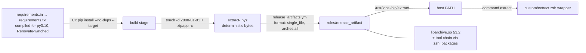

> **Status:** Draft

# extract tool packaging — Implementation Design

> **Date:** 2026-11-04
> **Scope:** Repackaging the `extract` tool for distribution: keep the typer CLI, vendor its pure-Python dependencies into a single-file reproducible zipapp (compiled lock + Renovate), make `standard_logging` optional, and install the artifact via the Ansible `release_artifact` role.
> **Related:** `docs/specs/2026-09-19-extract-password-recursive-design.md`, `docs/plans/archive/extract-password-recursive_7f3a9c2b.plan.md`

## Problem Summary

`extract` started as a shell-script-shaped idea and finished as a seven-module Python package (engine, handlers, orchestration, cli, …) with 196 passing tests. It is currently delivered the "script" way: a `bin/extract.py` shim that hand-rolls `sys.path` inserts to reach `libraries/python/extract` and the vendored `libraries/python/standards` submodule, wrapped by a zsh function. That model now fights three things:

1. **Install shape.** The shim only works when run from inside the zsh checkout; it cannot be installed on a host on its own.
2. **Dependency shape.** `typer` (→ `rich`, `shellingham`, `annotated-doc`, `click`) and `libarchive-c` are real third-party deps, but the repo has no pip/uv/pipx convention — the Ansible repo's established tool-delivery mechanism is the `release_artifact` role + `inventory/group_vars/all/release_artifacts.yml`.
3. **Standards coupling.** `logutil.py` hard-imports `standard_logging`, so the tool cannot run without the internal standards submodule.

This design removes the coupling and ships the tool through the convention the Ansible repo already enforces, **without rewriting the CLI**. All pure-Python deps are pinned in a compiled lockfile and vendored into the artifact at build time; the host needs only `libarchive.so` and the external tool chain.

## Design / Approach

### Dependency model

| Dependency | Current | Target | Rationale |
|---|---|---|---|
| `typer` (+ `click`, `rich`, `shellingham`, `annotated-doc`, `markdown-it-py`, `mdurl`, `pygments`) | pip / shim | **kept**, vendored into the `.pyz` | The CLI uses only the stable typer core (`Typer`, `Argument`, `Option`, `BadParameter`, `Exit`); rewriting it is churn with no user-visible benefit. Vendoring at build time removes the runtime pip step. |
| `libarchive-c` | pip | **vendored into the `.pyz`** | pure-Python `ctypes` binding (verified: no Python deps). It loads the **system** `libarchive.so` at runtime. |
| system `libarchive.so` | assumed present | **system package** (`libarchive13`/`libarchive`) | the ctypes binding needs only the shared library (≥ 3.2, for `archive_read_add_passphrase`); no Python package and no `-dev` package required |
| system tool chain (`7z`, `unzip`, `tar`, `cpio`, `ar`, `brotli`, `cabextract`, `rpm2cpio`, `lzip`, `ncompress`, `gzip`, …) | assumed present | **declared in `zsh_packages`**, except non-free/uncertain ones | makes the fallback chain reproducible per distro |
| `standard_logging` | hard import | **optional** (`try/except` + stderr fallback) | the standards contract: use it when available, degrade to a simplified logger otherwise |

### Runtime floor (Python ≥ 3.10)

The vendored `typer 0.27` / `click 8.5` declare `Requires-Python: >=3.10`, and `extract/cli.py` uses PEP 604 annotations (`str | None`) without `from __future__ import annotations` — so Python 3.9 raises at import time. The floor is explicit and enforced: the zsh role **skips extract with a warning** (never fails the role) when the target's `python3` is below 3.10. The three gating tasks live in §9 (keep them contiguous — a `when:` referencing an undefined var makes Ansible error, not skip).

**Alma 9 ships Python 3.9.** The default `dnf install python3` is 3.9, so extract is skipped there unless the host installs `python3.11`/`python3.12` from AppStream. This is documented rather than hidden.

### Version source of truth

Two pins exist for two different purposes; they are hand-synced at bump:

- **Build-side SoT:** `extract/__init__.py:__version__` — CI derives the tag, the asset filename (`extract-<v>.pyz`) and the build from it.
- **Deploy-side SoT:** the catalog entry in `release_artifacts.yml` (`version` + `asset`). This is what the role installs, per the repo's own "single source of truth for upstream release artifacts" doc.
- Nothing currently checks the two against each other; the bump procedure is: bump `__version__` → tag → CI builds `extract-<v>.pyz` → update the catalog pin + sha256.

### Artifact model

The tool ships as a **platform-independent, byte-reproducible zipapp** (`.pyz`): one compressed file containing the `extract/` package plus every pure-Python dependency from the lockfile. Runtime needs only the system `libarchive.so` and the external tools.



`release_artifact` already supports `format: single_file` (copies the asset to `<dir>/<bin|name>` at mode 0755) and `arches: {all: {...}}` (arch fallback is `arches[arch] | default(arches['all'])`), so no role changes are required.

### Repository split

| Repo | Keeps | Removes / never had |
|---|---|---|
| **`cupric/extract`** (new) | `extract/` (package + `__init__.py:__version__`), `tests/` (package tests: passwords, discovery, engine, handlers, orchestration, CLI basics/passwords), `tests/fixtures/`, `requirements.in`, `requirements.txt`, `requirements-dev.txt`, `renovate.json`, `scripts/build-zipapp.sh`, `bin/extract.py` | — |
| **`cupric/zsh`** (this repo) | `custom/extract.zsh`, `completion/_extract`, `tests/test_wrapper.py` (tests the zsh wrapper, not the package) | `libraries/python/extract/`, package tests, `bin/extract.py` move to `cupric/extract` |
| **`cupric/ansible`** | native deps, catalog entry, role wiring | — |

**Wrapper tests stay with the wrapper.** `tests/test_cli.py` resolves `BIN_SHIM = ZSH_ROOT/"bin"/"extract.py"` and `WRAPPER = ZSH_ROOT/"custom"/"extract.zsh"`; after the split, `TestWrapper` has no subject. Split it: `TestWrapper` (13 tests) becomes `cupric/zsh/tests/test_wrapper.py` (it sets an explicit `ZBIN`), and the remaining 183 tests move with the package.

## Implementation Details

### 1. `extract/cli.py` — unchanged (typer)

No rewrite. The packaging-relevant property is the module-level `app` (`typer.Typer`), relying on typer/click standalone mode for exit codes (help 0, `-p`+`-P` 2, `-p ''` 2, missing path 1, no args 2).

### 2. `extract/logutil.py` — optional standards contract

```python
"""Output discipline (spec §5): all of extract's status goes to stderr.

Uses standard_logging when importable; otherwise a simplified stderr logger.
"""

import sys

try:
    from standard_logging import log as _log  # type: ignore[import-not-found]
except ImportError:  # standards library not installed — simplified fallback
    def _log(level: str, *messages: str) -> None:
        sys.stderr.write(f"[{level}] {' '.join(str(m) for m in messages)}\n")


def log(level: str, *messages: str) -> None:
    """Log via standard_logging when present, forcing every level to stderr."""
    real_stdout = sys.stdout
    sys.stdout = sys.stderr
    try:
        _log(level, *messages)
    finally:
        sys.stdout = real_stdout


def redact(text: str, candidates: list[str]) -> str:
    """Mask every candidate in `text` (spec §8.3 — never log passwords)."""
    for candidate in candidates:
        if candidate:
            text = text.replace(candidate, "***")
    return text
```

### 3. `extract/__main__.py` — zipapp entry

```python
from extract.cli import app

app()
```

No `sys.exit` wrapper: typer/click raise `SystemExit` with the correct code.

### 4. `bin/extract.py` — dev shim (in `cupric/extract`)

```python
#!/usr/bin/env python3
"""dev shim — run the extract package from the checkout."""

import sys
from pathlib import Path

sys.path.insert(0, str(Path(__file__).resolve().parent.parent))
from extract.cli import app  # noqa: E402

if __name__ == "__main__":
    app()
```

(`chmod +x bin/extract.py`.)

### 5. `requirements.in` / `requirements.txt` — compiled lock

```text
# requirements.in
# requires Python >= 3.10 (typer/click floor)
typer>=0.12
libarchive-c>=3
```

Compile for the **floor**, not the build interpreter (otherwise a newer build image can pin `>=3.11` wheels and break the very hosts the floor protects):

```bash
uv pip compile --python-version 3.10 requirements.in -o requirements.txt
# or: pip-compile --python-version 3.10
```

The compiled lock has the full 9-distribution closure:

```text
# requirements.txt (compiled; Renovate bumps these)
annotated-doc==<pinned>
click==8.5.0
libarchive-c==5.3
markdown-it-py==<pinned>
mdurl==<pinned>
pygments==<pinned>
rich==<pinned>
shellingham==<pinned>
typer==0.27.3
```

Renovate managers: the `.txt` is tracked by `pip_requirements`; `requirements.in` by `pip-compile` (the `.in` extension is not matched by `pip_requirements`). `requirements-dev.txt` pins pytest (dev-only, not in the artifact).

### 6. `scripts/build-zipapp.sh` — reproducible artifact build

`--no-deps` makes the lock authoritative; normalising mtimes makes the digest stable across rebuilds (required for a pinned sha256 to survive a pipeline retry); `-c` compresses (~7.1 MB → 1.9 MB).

```bash
#!/usr/bin/env bash
set -euo pipefail

VERSION="${1:?usage: build-zipapp.sh <version>}"
REPO_ROOT="$(cd "$(dirname "${BASH_SOURCE[0]}")/.." && pwd)"
STAGE="$(mktemp -d)"
trap 'rm -rf "$STAGE"' EXIT

python3 -m pip install --quiet --disable-pip-version-check --no-deps \
  --target "$STAGE" -r "$REPO_ROOT/requirements.txt"

mkdir -p "$STAGE/extract"
cp -r "$REPO_ROOT/extract/." "$STAGE/extract/"
find "$STAGE" \( -name '__pycache__' -o -name '*.pyc' -o -name '*.dist-info' \) -prune -exec rm -rf {} +
rm -rf "$STAGE/bin"

cp "$REPO_ROOT/extract/__main__.py" "$STAGE/__main__.py"

# Deterministic archive: normalise mtimes BEFORE zipping. Use a date >= 1980
# (zipfile rejects pre-1980 timestamps); @0 would raise under `set -e`.
find "$STAGE" -exec touch -h -d '2000-01-01T00:00:00Z' {} +

mkdir -p "$REPO_ROOT/dist"
python3 -m zipapp "$STAGE" -c \
  -o "$REPO_ROOT/dist/extract-${VERSION}.pyz" \
  -p "/usr/bin/env python3"

# Guard against a silently incomplete bundle (--no-deps omits nothing audibly).
unzip -l "$REPO_ROOT/dist/extract-${VERSION}.pyz" | grep -q 'markdown_it/__init__.py' \
  || { echo "ERROR: dependency closure incomplete" >&2; exit 1; }

chmod 0755 "$REPO_ROOT/dist/extract-${VERSION}.pyz"
sha256sum "$REPO_ROOT/dist/extract-${VERSION}.pyz" | awk '{print $1}'
```

### 7. Ansible — catalog entry

```yaml
  extract:
    name: extract
    version: "0.1.0"
    # renovate: datasource=gitlab-releases depName=cupric/extract versioning=semver
    source: generic_url
    url_template: "https://gitlab.timepiggy.com/cupric/extract/-/releases/v{version}/downloads/{asset}"
    format: single_file
    checksum_source: captured_at_bump
    arches:
      all: { asset: "extract-0.1.0.pyz", sha256: "<sha256 of the .pyz>" }
```

Add `extract` to `release_artifacts_checksum_pending` (the CI "entries without real checksums" warning is expected to persist — do not remove the entry to silence it). If the repo is private, add `deploy_user` + `release_artifact_url_password` (vault).

### 8. Ansible — system packages

Only the **native** runtime is required — no Python packages.

| Distro | Additions |
|---|---|
| Debian | `libarchive13`, `p7zip-full`, `unzip`, `cpio`, `brotli`, `binutils`, `cabextract`, `rpm`, `lzip`, `ncompress`, `lz4`, `zstd`, `bzip2`, `xz-utils` |
| Arch | `libarchive`, `p7zip`, `unzip`, `cpio`, `brotli`, `binutils`, `cabextract`, `rpm-tools`, `lzip`, `ncompress`, `lz4`, `zstd`, `bzip2`, `xz` |
| Fedora / Alma | `libarchive`, `p7zip`, `p7zip-plugins`, `unzip`, `cpio`, `brotli`, `binutils`, `cabextract`, `rpm`, `lzip`, `ncompress`, `lz4`, `zstd`, `bzip2`, `xz` |

**`unrar` is best-effort and honest about its limits.** It is non-free (Debian) / RPM-Fusion (Fedora), and a missing name aborts the whole apt/dnf transaction — so it is a separate, non-fatal task. Note `unrar-free` (Debian `main`) does **not** provide the `unrar` binary the handler probes, so it is not used:

```yaml
- name: Install unrar (best-effort; needs non-free / RPM Fusion)
  become: true
  ansible.builtin.package:
    name: unrar
    state: present
  failed_when: false
```

Where `unrar` is unavailable, **unencrypted RAR still extracts via libarchive**; encrypted RAR requires `unrar` (enable non-free on Debian, RPM Fusion on Fedora). `.lrz`/`.zpaq` are absent from the lists; they are best-effort fallbacks (libarchive covers the common formats). Names are confirmed by the molecule run (Tier 1); `ncompress` supplies `uncompress` for `.tar.Z`.

### 9. Ansible — role wiring (all three tasks contiguous)

File: `cupric/ansible` → `roles/zsh/tasks/main.yml`, alongside the carapace block. **The three tasks must stay together and the preflight must precede any `when:` that reads it** — an undefined var in `when` makes Ansible error, not skip.

```yaml
# ── extract: password & recursive extraction (single-file zipapp) ─────────────
- name: Check Python floor for extract (>= 3.10)
  ansible.builtin.command: python3 -c "import sys; raise SystemExit(0 if sys.version_info >= (3, 10) else 1)"
  register: _zsh_extract_pyfloor
  changed_when: false
  failed_when: false

- name: Install extract from the release catalog
  ansible.builtin.include_role:
    name: release_artifact
  vars:
    release_artifact_name: extract
    release_artifact_dir: /usr/local/bin
    release_artifact_marker_dir: /usr/local/lib/extract
  when: _zsh_extract_pyfloor.rc == 0

- name: Warn when extract is skipped for an old Python
  ansible.builtin.debug:
    msg: >-
      extract not installed: target python3 is {{ _zsh_extract_pyfloor.stderr | default('') | trim
      or 'below 3.10' }} (Alma 9: install python3.11+ from AppStream to enable it).
  when: _zsh_extract_pyfloor.rc != 0
```

### 10. Ansible — release-artifact docs row (CI gate)

Add to `docs/reference/release-artifacts.md` `## Catalog`:

```markdown
| extract | 0.1.0 | GitLab releases `cupric/extract` | `roles/zsh` | CI build sha256 (re-capture per bump) |
```

`ci/check_release_artifacts.py` fails on a catalog entry missing from this table.

### 11. zsh integration — wrapper delegates to the installed binary

```zsh
if (( ! $+functions[extract_orig] )) && (( $+functions[extract] )); then
  functions[extract_orig]="${functions[extract]}"
fi
extract() {
  local arg
  for arg in "$@"; do
    case "$arg" in
      -R*|-p*|-P*|-F*|-r*|--recursive*|--password*|--password-file*|--force*|--remove*)
        if (( $+commands[extract] )); then
          command extract "$@"
        elif [[ -n ${ZBIN:-} && -f ${ZBIN}/extract.py ]]; then
          python3 "${ZBIN}/extract.py" "$@"
        else
          print -u2 "extract: the extract tool is not installed (run the ansible zsh role)"
          return 1
        fi
        return $?
        ;;
    esac
  done
  if (( $+functions[extract_orig] )); then extract_orig "$@"; else
    print -u2 "extract: plugin not loaded and the extract tool's flags not given"; return 1
  fi
}
```

### 12. zsh completion

`completion/_extract`, first line: `#compdef extract`.

> **Implementation correction (2026-11-04).** `zshenv:97` exports
> `ZBIN="${ZSH_DIR}/bin"` for every shell, so the original `[[ -n ${ZBIN:-} ]]`
> guard was always true and would have invoked the deleted `bin/extract.py` on
> every host. The shipped wrapper prefers an installed `extract` on `PATH` and
> only falls back to the shim when it actually exists. The wrapper suite is 17
> tests (13 moved + 4 new), not 13.

## Wiring Checklist

| Step | File | Change |
|------|------|--------|
| 1 | `cupric/extract: extract/` + `extract/__init__.py` | Move the package from `cupric/zsh` (`__version__` is the build-side SoT) |
| 2 | `cupric/extract: extract/logutil.py` | Optional `standard_logging` import + stderr fallback |
| 3 | `cupric/extract: extract/__main__.py` | `from extract.cli import app; app()` |
| 4 | `cupric/extract: bin/extract.py` | Dev shim (`chmod +x`) |
| 5 | `cupric/extract: requirements.in` | Direct deps + Python floor comment |
| 6 | `cupric/extract: requirements.txt` | Compiled for py3.10 (9 distributions) |
| 7 | `cupric/extract: requirements-dev.txt` | Pinned pytest (dev only) |
| 8 | `cupric/extract: scripts/build-zipapp.sh` | `--no-deps` + mtime normalise + `zipapp -c` + closure assert + sha256 |
| 9 | `cupric/extract: .gitlab-ci.yml` | Build `.pyz`, publish GitLab release asset |
| 10 | `cupric/extract: renovate.json` | Enable Renovate (`pip_requirements` + `pip-compile` managers) |
| 11 | `cupric/extract: tests/` | Move package tests + fixtures; clean stale `conftest.py` paths |
| 12 | `cupric/zsh: tests/test_wrapper.py` | Move `TestWrapper` (13 tests) |
| 13 | `cupric/ansible: inventory/group_vars/all/release_artifacts.yml` | Add `extract` catalog entry + checksum_pending |
| 14 | `cupric/ansible: docs/reference/release-artifacts.md` | Add the `## Catalog` row (CI gate) |
| 15 | `cupric/ansible: roles/zsh/vars/main.yml` | Add native deps per distro |
| 16 | `cupric/ansible: roles/zsh/tasks/main.yml` | Python-floor preflight + include + warn (contiguous, §9) + best-effort `unrar` |
| 17 | `cupric/ansible: roles/zsh/molecule/default/verify.yml` | Assert `extract --help` rc=0 (when Python ≥3.10) |
| 18 | `cupric/zsh: custom/extract.zsh` | Delegate to installed `extract`; honour explicit `ZBIN` |
| 19 | `cupric/zsh: completion/_extract` | `#compdef extract` |
| 20 | `cupric/zsh: libraries/python/extract/, bin/extract.py` | Remove (moved to `cupric/extract`) |

## Execution Order

1. **Move package + logutil + entry + lock (steps 1–7)** — CLI unchanged.
2. **Build artifact (steps 8–9)** — produce and smoke-run the `.pyz` (`python3 -S -E`).
3. **Move tests + wrapper test (steps 11–12)** — after the suite passes in `cupric/extract`.
4. **Publish the `.pyz` release** — exists with its exact sha256 *before* Ansible CI runs.
5. **Ansible wiring (steps 13–17)** — depends on a published `.pyz`; molecule-verify.
6. **zsh integration + removal (steps 18–20)** — depends on the installed binary.

**Dependency bump ≠ host update.** `release_artifact` keys on `version+arch`; a `requirements.txt` bump alone rebuilds at the same version and hosts report "already installed". A bump MUST bump the tool version (new tag → new `_ra_wanted`) and re-capture the sha256.

## Verification

```bash
# 1. Package tests (in cupric/extract; 13 wrapper tests moved to cupric/zsh)
python3 -m pytest tests/ -q          # expect 183 passed, 1 skipped, 1 xfailed, 7 xpassed
python3 -m pytest tests/test_wrapper.py -q   # in cupric/zsh: 13 passed

# 2. CLI parity (unchanged typer CLI)
python3 bin/extract.py --help
python3 bin/extract.py -p x -P f whatever.zip; echo "exit=$?"   # 2
python3 bin/extract.py -p '' whatever.zip; echo "exit=$?"       # 2
python3 bin/extract.py does-not-exist.zip; echo "exit=$?"       # 1

# 3. Hermetic build + run (catches an incomplete bundle; -E ignores PYTHON* env)
./scripts/build-zipapp.sh 0.1.0
sha256sum dist/extract-0.1.0.pyz          # rebuild and compare: identical
python3 -S -E dist/extract-0.1.0.pyz --help; echo "help=$?"      # 0
python3 -S -E dist/extract-0.1.0.pyz; echo "noargs=$?"          # 2
python3 -S -E dist/extract-0.1.0.pyz -p x -P f whatever.zip; echo "conflict=$?"  # 2
cd "$(mktemp -d)"; cp /path/to/cupric/extract/tests/fixtures/archives/plain/plain.tar.gz .
python3 -S -E /path/to/cupric/extract/dist/extract-0.1.0.pyz plain.tar.gz && test -f plain/a.txt && echo ZIPAPP_OK

# 4. Ansible (force a real install on a provisioned host)
ansible-playbook playbooks/zsh.yml -e @vars.yml -e force_reinstall=true
test -x /usr/local/bin/extract && extract --help >/dev/null && echo INSTALLED_OK
```

## What Stays Unchanged

- The `extract` CLI (`typer` + `extract/cli.py`) — no rewrite; tests move unchanged.
- The package's behaviour, `CHAIN_TABLE`, engine traversal, orchestration safeguards.
- `libarchive-c` remains the primary engine (AES zips, in-process, passphrase via API — never argv).
- The zsh wrapper's C6 one-shot guard and flag-pattern delegation.
- The `release_artifact` role itself.

## Risk Mitigations

| Risk | Mitigation |
|------|-----------|
| Python 3.9 host (Alma 9) can't run the artifact | Explicit ≥3.10 floor; preflight skips with a warning (never fails the role); Alma-9 AppStream note. |
| Wrapper tests lose their subject | `TestWrapper` (13) moves to `cupric/zsh/tests/test_wrapper.py`; uses the `ZBIN` seam. |
| `requirements.txt` isn't a real lock | `uv pip compile --python-version 3.10` (full closure); `pip install --no-deps`; build asserts `markdown_it/__init__.py` is present. |
| Lock resolves above the floor | Compile with `--python-version 3.10`, not the build interpreter. |
| Non-reproducible `.pyz` (mtime) | `touch -d '2000-01-01'` before `zipapp`; digests identical across rebuilds. |
| Verification misses an incomplete bundle | `python3 -S -E` (hermetic) + exit matrix (0/1/2). |
| Dependency bump never reaches hosts | Dep bump ⇒ tool version bump + sha re-capture; `_ra_wanted` is `version+arch`. |
| Renovate not enabled for the new repo | `cupric/extract: renovate.json`; `pip_requirements` (.txt) + `pip-compile` (.in). |
| Version SoT divergence | Build-side `__version__`, deploy-side catalog pin; bump procedure syncs them. |
| `unrar`/non-free breaks apt/dnf | Best-effort separate task; `unrar-free` is not used (wrong binary). RAR via libarchive; encrypted RAR needs `unrar`. |
| `libarchive-c` vs system `libarchive.so` | Binding pinned; shared library host-provided, ≥ 3.2 (all matrix distros qualify). |
| `.pyz` size | `zipapp -c`; ~1.9 MB compressed. |
| Private artifact 401s | `deploy_user` + `release_artifact_url_password` (vault). |
| `captured_at_bump` CI warning persists | Expected by design; do not remove the `checksum_pending` entry. |
